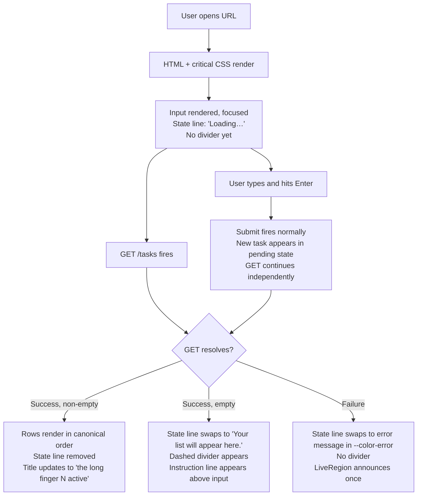
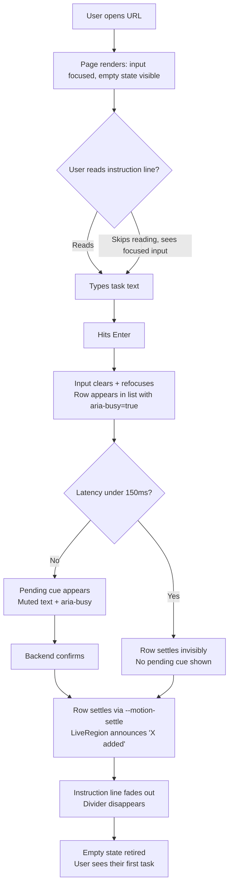
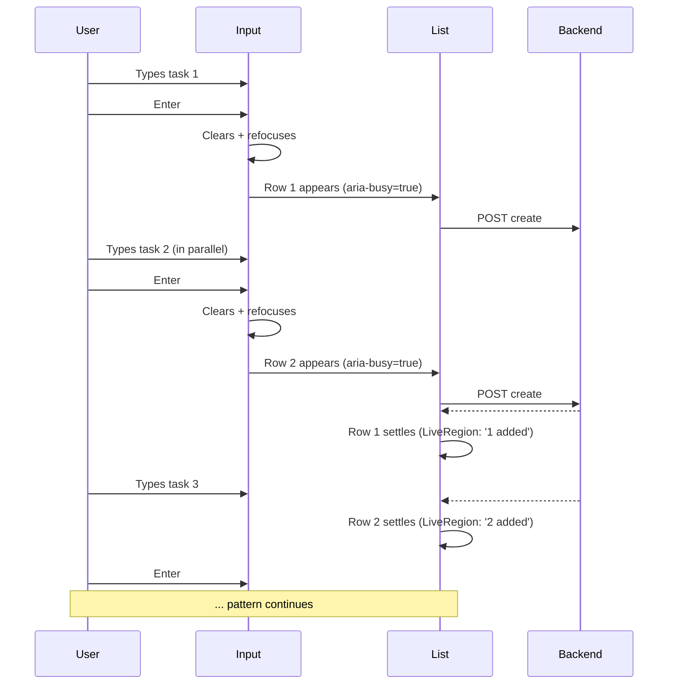
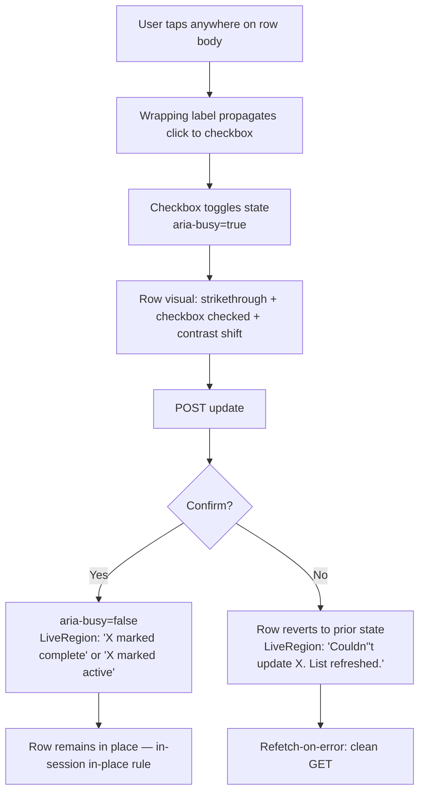
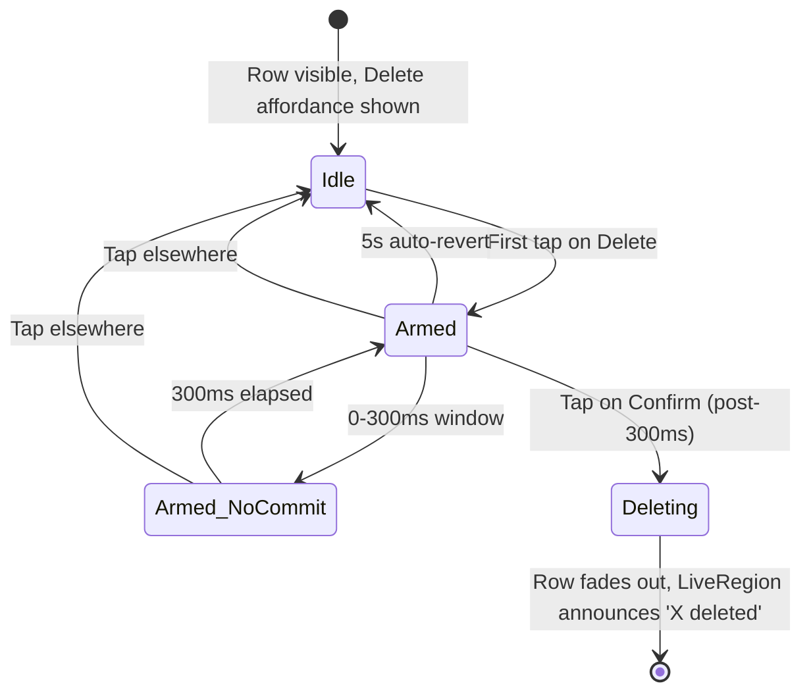
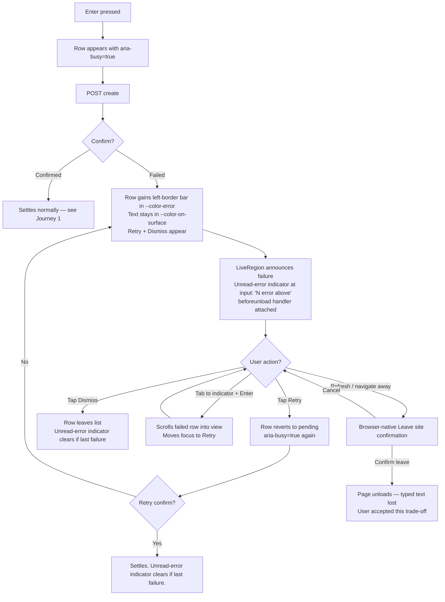
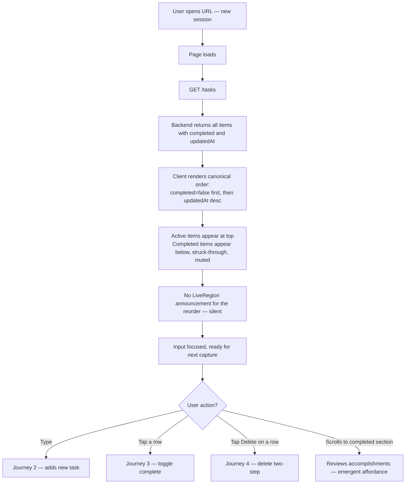
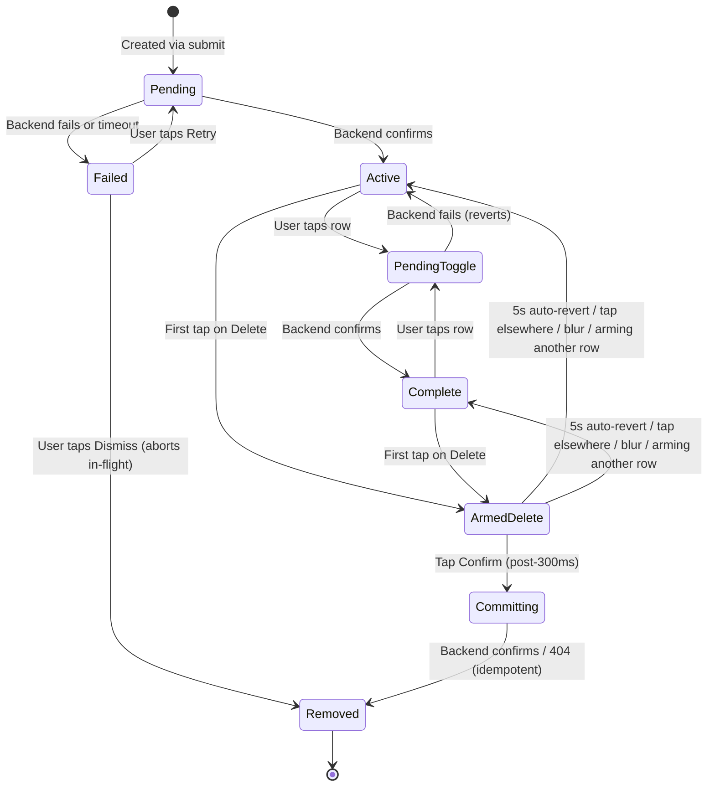

# UX Design Specification the long finger

**Author:** Keith
**Date:** 2026-06-10

---

<!-- UX design content will be appended sequentially through collaborative workflow steps -->

## Executive Summary

### Project Vision

A single-user, full-stack Todo App whose first version succeeds on immediacy and trust rather than features. Opening the app shows the Todo List instantly; adding a task is one short action; completion status is obvious at a glance; and the list reliably survives refreshes and restarts. The UX must make the Core Task Loop — view, create, complete/uncomplete, delete, return — feel effortless and self-evident, with no onboarding. The immediacy thesis is about feedback latency, not about minimizing taps on destructive acts: every interaction responds instantly, but irreversible actions may ask the user to mean it.

### Target Users

A single Primary User persona: an individual managing a short personal task list (up to ~100 items) in a desktop or mobile browser. They are unauthenticated and land directly on the list. They value speed of capture, at-a-glance status, and persistence they can trust. No assumptions about high technical skill — the app must be usable cold, without instruction (SM-1). Context matters: this person may arrive mid-task, on mobile, with one thumb free — which sets the bar for tap target size and input placement. Keyboard-only and screen-reader users are in-scope members of this persona (NFR-3), not a separate audience.

### Key Design Challenges

1. **Confirmed-but-instant interactions** — The UI only treats create/complete/delete as done after backend confirmation, yet must feel immediate (<300 ms after response). Pending treatment must avoid flicker: no pending styling below a ~150–200 ms threshold, and a minimum hold duration once shown. During an in-flight action, only the pending item is locked (repeat taps absorbed silently, double-submit designed out); the rest of the list stays live.
2. **Irreversible delete with no undo** — Undo, archive, and soft-delete are out of scope (NG-6), so an accidental delete on a 320 px screen is permanent data loss. Mitigation must come from the design itself (spatial separation and/or an inline confirm step — open decision below); a modal dialog is rejected as both calm-breaking and accessibility-expensive.
3. **No editing after creation** — Users will typo, and their only recourse is delete-and-retype (NG-7). Cold users will try to tap text to edit it; the design must anticipate that dead-end without breaking SM-1.
4. **Recoverable errors that preserve trust** — Failed loads and mutations need clear, recoverable error states that keep the last-confirmed list intact (FR-8, NFR-6). Recovery verb: refetch-on-error as the universal recovery path. A failed create must preserve the user's typed text.
5. **Status clarity without color reliance** — Completed vs. active must be distinguishable via structure/iconography/text, keyboard reachable and screen-reader understandable (FR-2, NFR-3), at widths from 320 px up. Pending-state cues must obey the same non-color rule.
6. **Zero-guidance usability (SM-1)** — Every affordance must be self-evident enough that a cold user completes the full journey unaided. The empty state only onboards *create*; complete and delete must be self-evident from the item row itself. This spec defines the SM-1 acceptance protocol (below) as a deliverable.

### Design Opportunities

1. **Empty state as onboarding — and as a success state** — With no tutorial allowed, a well-crafted empty state (FR-1) can teach the app in one glance and funnel straight into first creation. It is also a recurring state for diligent users, so it must read as accomplishment, not absence.
2. **Single-view calm** — With no nav, settings, or filters, the design can spend its whole budget on one excellent list view: generous touch targets, clear hierarchy, satisfying completion feedback. Named tension: with up to 100 items and completed items remaining visible, the view must stay scannable over time (see open decision on completed-item placement).
3. **Trust through visible persistence** — Settled vs. pending cues (above the flicker threshold) make backend-confirmed reliability *felt*, turning an NFR into a perceived product quality.

### Early Design Decisions (multi-agent review, 2026-06-10)

Consensus decisions carried into this spec:

- **Pending interaction model:** per-item lock during in-flight actions; rest of list stays live; repeat taps on a pending item are absorbed, not errored. Use `aria-disabled` + click guard (not `disabled`) so focus is preserved.
- **Flicker threshold:** no visible pending treatment under ~150–200 ms; minimum hold once shown; implemented once as a shared utility. `aria-busy` is true from t=0 even while visual treatment is delayed (semantic truth ≠ visual calm).
- **Error recovery:** refetch-on-error (clean GET) is the universal recovery path; failed create preserves typed input; mutation errors surface near the action or in one persistent polite live region (one per view, not per row).
- **Multi-tab/staleness fence:** stale tabs reconcile on next reload/refetch; no live sync, polling, or websockets in v1.
- **Ordering is computed, never stored:** list order must be a pure function of item data (`completed`, `createdAt`, `updatedAt`) so a fresh GET always reproduces it.
- **SM-1 acceptance protocol:** 5 participants, moderated, observer silent after URL open; task script = the Core Task Loop as pass/fail steps; failure = intervention, abandonment, or >60 s stuck on one step; pass bar = 4/5 with the failure analyzed and dispositioned; keyboard-only and screen-reader runs are separate pass/fail conformance checks, not folded into the 5. Observation list includes: does de-emphasized-in-place read as "done" to a cold user; any accidental delete.
- **Undo stays deferred:** recorded for the future — if revisited, backend soft-delete (`deletedAt`) is the boring path.

Open decisions flagged for resolution during core experience design:

1. **Delete safety:** inline two-step arm-then-confirm (Sally/Winston position) vs. spatial design only with an SM-1 tripwire escalating to inline confirm (John position). Modal dialogs are ruled out either way.
2. **Completed-item placement over time:** stay in place + de-emphasize (matches PRD FR-5 as written) vs. sink below actives on server confirm vs. hybrid (de-emphasize in place during the session, sink on next load). Any choice other than stay-in-place requires a one-line FR-5 amendment to the PRD.

## Core User Experience

### Defining Experience

The defining experience is **frictionless capture into a trustworthy list**. The user opens the app and can begin typing a task immediately — no navigation, no account, no mode switch. One short action (type + submit) creates the item; one tap toggles it done; the list is always exactly where they left it. The Core Task Loop (view → create → complete/uncomplete → delete → return) is the entire product, and the create action is its keystone: if capture is instant, everything else follows.

### Platform Strategy

- **Single responsive web app**, 320 px through desktop widths (NFR-4). No native apps, no install, no offline mode (NG-5).
- **Touch-first on mobile:** primary actions sized for one-thumb use; create input reachable without scrolling.
- **Full keyboard parity on desktop:** every core action keyboard-reachable (NFR-3); Enter submits a new task from the input.
- **No device-capability dependencies** — no notifications, camera, geolocation, or storage APIs beyond the backend API itself.
- **Stale tabs reconcile on reload/refetch** — no live sync in v1 (fence from multi-agent review).

### Effortless Interactions

- **Capture:** open → type → Enter. The create input is permanently visible at the top of the view — never behind a button, modal, or navigation step. After submit, the input clears and refocuses so consecutive captures chain naturally.
- **Status toggle:** one tap/click/keypress on a large, obvious control flips complete/active. No menus, no edit mode.
- **Return:** the list is simply *there* on every open — loading resolves into the exact list the user last confirmed, with no interstitial or sign-in.
- **Validation:** empty and >200-character descriptions are caught inline as the user acts, never after a round-trip surprise.

### Critical Success Moments

1. **The cold open (first 5 seconds):** an empty state that teaches the whole app in one glance and funnels straight into first creation. SM-1 lives or dies here.
2. **The first create:** the item appears in the list, backend-confirmed, fast enough to feel instant. This is the "it just works" moment.
3. **The refresh test:** the user reloads (or returns next day) and everything is exactly as left. This converts the app from a toy into a tool (SM-2).
4. **The completion beat:** marking an item done gives satisfying, accessible feedback — the emotional payoff of the entire product.
5. **The graceful failure:** a failed action explains itself, preserves the list and any typed text, and offers a way forward. Trust survives the first error or it doesn't survive at all.

### Experience Principles

1. **Capture is sacred** — nothing may ever sit between the user and adding a task: no modes, no modals, no focus theft.
2. **Respond instantly, confirm honestly** — every input gets immediate feedback, but state is only shown as settled once the backend confirms; below the flicker threshold the app simply appears to do the thing.
3. **Nothing moves unless the user moved it** — layout stability is trust: no jank during loading, no reflow under the user's thumb mid-action.
4. **The list is the interface** — no navigation, settings, or secondary screens; every design improvement is spent on the single list view.
5. **Errors are calm and lossless** — failures explain, preserve, and offer retry; they never delete, disable, or dead-end.
6. **Self-evident over explained** — every affordance must survive the cold-user test (SM-1); if it needs a tooltip, it needs a redesign.

## Desired Emotional Response

### Primary Emotional Goals

- **Calm** — the dominant feeling. One quiet view, nothing moving unexpectedly, no badges or noise competing for attention. Using the app should lower cognitive load, not add to it.
- **Trust** — the differentiating feeling. The user believes, without thinking about it, that the list is exactly what they last confirmed — across taps, refreshes, and even failures. Trust is the emotion that makes them come back tomorrow.
- **In control** — every change to the list is one the user made, understood, and could see happening. The app never acts on its own.
- **Quiet accomplishment** — completing a task delivers a small, satisfying beat of progress; an emptied or well-tended list reads as achievement, not absence.

### Emotional Journey Mapping

- **First discovery (cold open):** *immediate orientation, zero intimidation.* "I already know how to use this" within five seconds. The empty state invites rather than instructs.
- **During capture:** *relief.* The thought is out of their head and safely stored before it slips away. No ceremony to interrupt the next thought.
- **On completion:** *micro-satisfaction.* A clear, accessible state change that feels like progress — the emotional payoff of the product.
- **When something fails:** *reassured, not alarmed.* The error is calm, the list is intact, their typed text survives, and a way forward is offered. The feeling to engineer is "nothing was lost," never "what just happened?"
- **On return:** *recognition.* The list is exactly as left — the moment that converts the app from toy to tool, felt as reliability rather than noticed as a feature.

### Micro-Emotions

Most critical for this product's success:

- **Confidence vs. confusion** — the SM-1 axis. Every affordance must answer "what does this do?" before the question forms.
- **Trust vs. skepticism** — built in the pending/confirmed seam. Honest settled-state cues and lossless errors compound into trust; one silently lost item destroys it permanently.
- **Accomplishment vs. frustration** — completion must feel rewarding; delete must never feel dangerous; the no-edit dead-end (typo → delete → retype) must feel like a quick redo, not a punishment.
- **Satisfaction over delight** — deliberately chosen: no confetti, no streaks, no gamification. The product personality is a well-made tool, not a companion.

### Design Implications

- **Calm** → restrained palette and motion; no layout shift; generous whitespace; one persistent live region instead of toast storms.
- **Trust** → honest state styling above the flicker threshold; backend-confirmed transitions; refetch-on-error recovery that visibly restores certainty; typed text always preserved.
- **In control** → per-item pending locks that absorb impatience silently; destructive actions that ask the user to mean it without modal interruption; nothing reorders under the thumb.
- **Quiet accomplishment** → a completion treatment that is visually satisfying (clear strike/settle) yet non-celebratory; an empty state that congratulates when reached through work.
- **Confidence** → affordances that look like what they do (a checkbox-like toggle, a labeled delete), tap targets sized for one-thumb reach.

### Emotional Design Principles

1. **Calm is the brand** — when in doubt, remove motion, color, and noise rather than add them.
2. **Trust is engineered, not asserted** — every state the user sees must be literally true of the backend, or honestly marked as pending.
3. **Failure is where loyalty is won** — invest disproportionate design care in error moments; they're rare but emotionally decisive.
4. **Reward with progress, not spectacle** — satisfaction comes from the work being done, never from the app performing.
5. **Never make the user feel stupid** — dead-ends (no edit, char limit, empty input) are framed as gentle guidance, not rejection.

## UX Pattern Analysis & Inspiration

### Inspiring Products Analysis

**Things (Cultured Code)** — calm task management as a craft discipline.

- *Problem solved elegantly:* makes a powerful task system feel like a quiet paper list. Whitespace, type hierarchy, and restraint do the work that other apps delegate to chrome and color.
- *The completion beat:* checking off a task is the signature interaction — a precise checkbox animation, a brief settled pause while the item remains in place, then a tidy departure. Satisfaction without spectacle, and the pause preserves spatial stability (our principle: nothing moves unless the user moved it).
- *Error/edge handling:* almost invisible — state changes are so reliable the user never wonders whether something saved. Reliability *as* the experience.
- *Why users return:* the app feels lighter than the work it manages. That is precisely our "calm is the brand" goal.

**TeuxDeux** — radical single-view, text-first simplicity.

- *Problem solved elegantly:* proof that a todo product can succeed with essentially one screen and one input. Typography is the interface; tasks read like a handwritten list.
- *Capture pattern:* click/tap into an always-present input, type, Enter — repeat. No add button ceremony, no modal, chained capture by default. This is the direct model for our "capture is sacred" principle.
- *Completion treatment:* a plain strikethrough — structural, not color-dependent, instantly legible. Directly satisfies FR-2/NFR-3.
- *Onboarding:* there is none, and none is needed — the empty state plus a visible input is the entire tutorial. The existence proof for SM-1's zero-guidance bar.

**Linear** — speed as the foundation of trust.

- *Problem solved elegantly:* makes a data-heavy tool feel instant; latency is treated as a product defect, not an engineering metric.
- *Honest immediacy:* interactions respond in keystroke-time, and the UI never lies about state — work happens fast enough that pending states rarely need to appear. The model for our flicker threshold: below ~150–200 ms, the app should simply appear to do the thing.
- *Keyboard parity:* every action reachable from the keyboard, not as an afterthought but as the primary path — our NFR-3 desktop benchmark.
- *Restraint at scale:* dense information, yet calm — hierarchy from spacing and weight rather than boxes and borders.

### Transferable UX Patterns

**Interaction patterns:**

- **Always-present inline capture** (TeuxDeux) → permanent input at the top of the list; Enter submits; input clears and refocuses for chained capture.
- **The settled completion beat** (Things) → check → brief in-place settle → de-emphasis; satisfying, accessible, non-celebratory.
- **Keystroke-time responsiveness with honest state** (Linear) → respond instantly, show pending only above the flicker threshold, never fake a confirmation.
- **Inline, non-modal everything** (all three) → none of these products interrupts the flow with dialogs for routine actions; supports our two-step inline delete direction.

**Visual patterns:**

- **Typography-first hierarchy** (TeuxDeux, Linear) → task text is the largest, darkest element; controls are quiet until needed.
- **Structural completion signal** (TeuxDeux) → strikethrough + checked control + reduced contrast: three redundant non-color cues.
- **Whitespace as calm** (Things) → generous row height doubles as one-thumb tap-target sizing on mobile.

**Navigation patterns:**

- **No navigation** (TeuxDeux) → the list is the app. We adopt this wholesale; our scope (NG-1–NG-7) makes it natural.

### Anti-Patterns to Avoid

- **Gesture-only affordances** (Clear's failure mode) — swipe-to-delete or swipe-to-complete with no visible control fails cold users (SM-1) and keyboard/screen-reader users (NFR-3). Every action gets a visible, labeled control.
- **Optimistic UI that lies** (common in fast todo apps) — showing an item as saved before the backend confirms contradicts our trust thesis; we render honest pending states instead.
- **Modal confirmation for routine destructive actions** — ruled out in multi-agent review: accessibility-expensive, calm-breaking.
- **Celebration inflation** (confetti, streaks, badges) — gamification contradicts "reward with progress, not spectacle."
- **Toast storms** — stacking transient notifications for every action; we use one persistent polite live region.
- **Add-task ceremony** — a floating "+" button that opens a form/modal adds two steps to the most sacred action; capture must be zero-step.

### Design Inspiration Strategy

**Adopt:**

- TeuxDeux's always-present inline capture — it *is* our core experience.
- Things' settled completion beat — it *is* our emotional payoff, and its in-place pause aligns with the layout-stability principle.
- Linear's keyboard parity — full keyboard path for the entire Core Task Loop.

**Adapt:**

- Things' polish → simplified: their animation craft, at MVP budget — one well-tuned strike/settle transition, not a motion system.
- Linear's instant-confirm feel → within our backend-confirmed constraint: the shared flicker-threshold utility makes confirmed-but-instant *feel* like Linear.
- TeuxDeux's strikethrough → extended for accessibility: paired with an explicit checked control and `aria` state so the signal is structural for every user.

**Avoid:**

- Clear's gesture-dependence, optimistic-UI dishonesty, modal confirms, gamification, capture ceremony — each conflicts with a named principle above.

## Design System Foundation

### 1.1 Design System Choice

Lightweight, self-authored foundation: native HTML form elements styled for visual consistency, a small primitive layer for shared patterns, CSS Modules for component styles, CSS custom properties for design tokens. No third-party headless component library in v1. Tailwind CSS may be used in place of CSS Modules if the implementing developer is already fluent — this is a workflow choice. Once chosen, the styling layer is the one decision in this stack with high migration cost; the rest of the stack is incrementally adjustable. Mixing CSS Modules and Tailwind in the same codebase is not permitted; the choice is binary and made once.

### Rationale for Selection

- Component surface is small (~5–8 components) and contains no composite widgets (combobox, popover, menu, dialog). The components we ship are all correct natively when paired with proper `<label>` association and `aria-live` / `role` attributes. NFR-3 is satisfied at the HTML layer, not by an additional dependency.
- Modal dialogs are ruled out by the spec, eliminating the strongest case for a headless library.
- Smallest sufficient stack: zero added install graph, zero build-config burden beyond the bundler default, smallest payload — supporting the ~150–200 ms flicker threshold and keystroke-time responsiveness goals.
- Layout stability is easier to control with hand-authored CSS than with cascading utility classes; "nothing moves unless the user moved it" is easier to guarantee when every rule is explicit.
- Tokens carry the design-system value: palette, type scale, spacing, motion durations, focus ring — all in one place, swappable later without restructuring components.

### Implementation Approach

- Native HTML form elements as the substrate: `<button>`, `<input>`, `<label>`, `<input type="checkbox">`. ARIA attributes added only where the native semantics need supplementing (e.g., `aria-busy` on a pending row, `aria-live="polite"` on the single error region).

- Native elements are styled for visual consistency, not used as-rendered. Native semantics (keyboard, ARIA, label association) are preserved at the HTML layer; visual quirks (OS checkboxes, iOS input zoom, browser focus rings) are normalized at the primitive layer. SM-1 requires the cold user to recognise the same control across devices; this is how.

- Primitive layer (~4 small components). A small set of shared primitives owns the cross-browser visual normalization, focus styles, and the prop-convention discipline (see Post-MVP Option Preservation below). Initial set:
  - `<Button>` — focus ring, hit area, disabled state, pending state.
  - `<TextInput>` — padding, font size (≥16 px on touch to prevent iOS zoom), validation surface.
  - `<Checkbox>` — visually hidden native `<input type="checkbox">` with a styled `::before` on the label for consistent cross-browser visual. Prop API: `checked` / `onCheckedChange`.
  - `<LiveRegion>` — wraps `role="status" aria-live="polite"`.

  Recipes (`TodoItem`, `CaptureInput`, `EmptyState`, `ErrorBanner`) compose these primitives; they do not re-implement focus or reset patterns.

- The primitive layer is terminal. The four primitives above are the complete set. New visual patterns become recipes that compose primitives, not new primitives. If a genuinely new primitive becomes necessary (Menu, Popover, Combobox, Dialog), that *is* a Radix reassessment trigger — install the library instead of extending the local layer.

- CSS Modules per component, importing from a single `tokens.css`. No global reset beyond a small normalize block; no runtime CSS-in-JS.

### Customization Strategy

- **Tokens (`tokens.css`) — semantic naming, committed:**
  - **Surfaces:** `--color-surface`, `--color-surface-muted`, `--color-on-surface`, `--color-on-surface-muted`.
  - **Accents:** `--color-accent` (focus + affordance), `--color-error`.
  - No literal colour names (`--color-white`, `--color-grey-100`, `--color-blue-500`). Dark mode is a redefinition of these variables in a `prefers-color-scheme: dark` block, not a rewrite.
  - **Typography:** `--font-body`, `--font-size-item`, `--font-size-secondary`, `--font-size-micro`; weights via `--font-weight-regular | --medium | --semibold`.
  - **Spacing:** `--space-1` through `--space-6` on a 4 px base; `--row-height-touch` tuned for one-thumb tap targets at 320 px.
  - **Motion:** `--motion-instant` (≤150 ms), `--motion-settle` (200–250 ms). No celebratory motion tokens.
  - **Focus ring:** `outline: 2px solid var(--color-focus); outline-offset: 2px;` applied consistently across all primitives. Non-color-only by virtue of offset and width — readable in high-contrast and forced-colour modes.

- **Enforcement: token-name lint + literal-colour block.** CI rejects new CSS custom properties in `tokens.css` that don't match the semantic vocabulary. PRs introducing a literal CSS colour value in a component file are blocked; new colour needs become semantic tokens first.

- **Focus-ring enforcement.** A stylelint rule rejects any `outline: none` declaration not paired with a `:focus-visible` rule using `--color-focus`. This is the load-bearing accessibility control surface; it cannot be a doc-only rule.

- **No theme switching in v1** (light only). Dark mode deferred; tokens are structured so a `@media (prefers-color-scheme: dark)` block can redefine them without restructuring components.

### Post-MVP Option Preservation

The minimal v1 stack is deliberately small but is designed so the post-MVP path does not require a rewrite. Three rules keep options open:

1. **Local component APIs mirror headless-library conventions.** Primitives use prop names that match Radix UI's: `checked` / `onCheckedChange` for toggles, `open` / `onOpenChange` for any future disclosure state, `value` / `onValueChange` for any future selectable input. Swapping a primitive for `Radix.Checkbox` later is a one-file change, not a refactor across consumers.

2. **Tokens stay framework-agnostic.** All design decisions live in `tokens.css` as CSS custom properties. They will continue to work if we later adopt a headless library, switch styling solutions, or add dark-mode support.

3. **Reassessment triggers — when to install a headless library.** Adopt Radix UI (peer packages, installed per-primitive) the first time any of the following lands:
   - A date or time picker (e.g., due dates per NG-3 / NG-4).
   - A combobox, multi-select, or autocomplete (e.g., tags).
   - A dropdown menu or popover (e.g., priority, sort order).
   - A focus-trapped overlay of any kind (e.g., undo banner with keyboard-reachable action, per NG-6 if revisited).
   Radix is named here so the choice is not re-litigated at trigger time. Until then, the dependency would pay no rent.

#### Discipline Lever: Where the Conventions Live

The prop-convention rule is concentrated in the primitive layer, not scattered across every recipe. The four primitives (`Button`, `TextInput`, `Checkbox`, `LiveRegion`) are the only place prop names need to match Radix conventions. Recipes compose them through their own project-specific APIs. This means:

- Prop-convention drift is detectable in four files, not twenty.
- A PR-template checkbox ("Does this primitive's API match the Radix-equivalent component?") covers the whole discipline.
- When a reassessment trigger fires, the migration is replacing four files, not refactoring every consumer.

#### Sequencing Gate — The Port Ships Or The Feature Waits

When the first sprint touches a deferred-feature area (due dates, tags, undo, sort order), "install Radix UI and port the relevant primitive" is a non-negotiable task in that sprint. If sprint scope cannot accommodate the port, the feature waits or scope is reduced elsewhere — the port is never the variable that gets cut under deadline pressure. Authority to skip the port is explicitly held jointly by PM and tech lead, never delegated to the implementing engineer under sprint pressure.

### Conditions That Should Trigger a Re-Evaluation of the Stack Itself

The choices above are correct under the spec's current conditions: one developer, calm aesthetic non-negotiable, no composite widgets in v1, smallest payload preferred. Reconsider the whole stack — not just the reassessment triggers — if any of these change:

- A second developer joins. Tailwind + Radix or Shadcn/ui carry more shared mindshare than hand-authored CSS Modules and reduce collaboration friction.
- The implementing developer is already Tailwind-native. Path A imposes a different idiom; Path B has no learning cost for that developer and would score the same on every other axis.
- A composite widget (date picker, combobox, menu, popover) lands in v1.x rather than v1.5. The deferral becomes academic; adopt Tailwind + Radix or Shadcn/ui from that point forward.
- The calm-aesthetic principle is relaxed or revised. Shadcn/ui becomes the fastest path with no material loss against the remaining principles.

These are conditions, not predictions. Recording them removes the cost of re-deriving the trade-offs later.

#### Review Cadence — When the Conditions List Gets Read

The list above is re-read at two trigger events:

1. **New developer onboarding.** Onboarding includes an explicit checkbox to walk the Conditions list and flag any that have become true.
2. **Start of any deferred-feature sprint.** Reviewed alongside the Radix-onboarding gate above.

Without these triggers, the list is words in a doc that no one is responsible for noticing.

## Defining Experience: Capture-and-Confirm

### 2.1 The Defining Interaction

The defining experience is **capture-and-confirm**: a user types a task into a permanently-visible, always-focused input at the top of the list, presses Enter, and watches the task settle into the list as a backend-confirmed item. Below the flicker threshold (~150 ms) the app appears to do the thing instantly; above it, an honest pending cue acknowledges the request while the confirmation completes.

This is the interaction that defines the product. The other three actions in the Core Task Loop (complete, delete, return) operate on state that capture-and-confirm produced. If capture is friction-free and trustworthy, the rest of the product follows; if it isn't, no amount of polish elsewhere can recover.

The user-facing description, in one sentence: **"You type, you press Enter, it's on the list."**

**Honest pending is non-negotiable for v1.** The model is load-bearing for the trust thesis; replacing it with optimistic UI would be a product-identity change, not a tactical compromise. If p95 latency exceeds 800 ms at launch readiness, the *latency* is addressed — not the model. No "temporary" optimistic UI. Any future departure from this model is a PRD revision, not an engineering shortcut.

### 2.2 User Mental Model

Users approach a personal todo app with one of two mental models:

- **The paper list.** A vertical column of tasks, written top-to-bottom, crossed off as they're done. Capture is "write the next thing on the next line." There is no save button; the act of writing is the save. This is the model the cold-user test (SM-1) assumes, and the model our design adopts.
- **The form-based app.** A "+ Add task" button opens a modal or form, the user fills fields, hits Submit. Capture is two clicks and a context switch.

The paper-list model is older, simpler, and matches the immediacy thesis. The form-based model is what most todo apps default to, because it scales to features (due dates, priority, tags) that we deferred. Our scope makes the paper-list model viable; our principles make it required.

**Expectations the user brings (and we must honour):**

- The input is *there*. They do not look for a button to add a task.
- Typing is the only ceremony. No mode switch, no second tap, no field to populate.
- Enter submits. Tab does not submit. The keyboard contract is the same as every notes app the user has ever used.
- The typed task appears in the list. If it doesn't appear, it wasn't saved. There is no third state ("submitted but invisible").

**Likely friction points (and our response):**

- **Wanting to edit a typo after submit.** Users will try to tap the task text. Our response: no edit affordance, no edit on tap. The delete-and-retype recovery path is the only path. The empty state may seed an expectation; the item row must not.
- **Trying to add multiple tasks quickly.** Users will type, hit Enter, start typing again before the previous task has confirmed. Our response: input clears and refocuses on submit (not on confirm), so chained capture works at typing speed regardless of backend latency. The previous task is pending in the list; the next task is already being typed.
- **Wondering whether a task saved.** Users will hesitate after Enter if the response isn't immediate. Our response: instant input clear (signals "submitted"), settled item appearance below flicker threshold (signals "confirmed"), honest pending cue above it (signals "saving"). At no point is the user left wondering.

### 2.3 Success Criteria

The defining interaction succeeds when:

- **Time to first task ≤ 5 seconds** from cold open. The empty state funnels directly to the input; the input is already focused; the user types and submits without reading instructions.
- **Time to second task ≤ time to first task minus the typing time.** The input clears and refocuses on submit, so chained capture has zero overhead between tasks. Capturing five tasks in a row should feel like typing five lines into a notes app.
- **Below ~150 ms backend latency, the user perceives the action as instant.** No pending cue appears. The task simply lands settled.
- **Above ~150 ms, the user perceives an honest pause, not a freeze.** A pending cue appears, with a minimum hold duration once shown so it doesn't flicker. The input is already cleared and ready for the next task; the pending state lives in the list row, not at the input.
- **A typed task never silently fails.** A failed create surfaces a clear error, preserves the typed text, and offers retry. A confirmed task never reverts. The list reflects the backend's truth, always.
- **A keyboard-only user reaches and operates the input with no navigation.** Tab order is: input first. Enter submits. Esc clears pending input if the user changes their mind before submit.
- **A screen-reader user hears their submission acknowledged.** The newly added item is announced via the single persistent polite live region (`<LiveRegion>` primitive). Pending → confirmed transitions do not generate additional announcements.
- **The pending cue is detectable but calm — measured.** The pending state maintains contrast ≥3:1 against the settled state using the dedicated `--color-pending` token against `--color-on-surface`. Validated by an SM-1 acceptance step: *"After submitting, the participant identifies whether the item is fully saved or still saving, without prompting, within 3 seconds."*

### 2.4 Novel vs. Established Patterns

**Established (adopted wholesale):**

- *Always-present inline capture* (TeuxDeux, Linear, every notes app). The input is permanently at the top, permanently focused. This is not new; it is the *correct* pattern for this scope.
- *Enter to submit, input clears and refocuses* (every list-based capture UI for the last twenty years). Users know this contract; we honour it exactly.
- *Inline error display with preserved input* (any reasonable form pattern). Failed creates do not lose the user's text.

**Novel (calibrated middle ground, not invented):**

- *Confirmed-but-instant feedback*. Most fast todo apps lie: optimistic UI shows the item as saved before the backend confirms, then silently rolls back on failure. We refuse this; we also refuse visible roundtrip latency. The middle path — invisible below ~150 ms, honestly pending above it — is not original to this product, but its application here (with the shared flicker-threshold utility, the minimum-hold rule, `aria-busy` from t=0 with delayed visual treatment) is more deliberately engineered than typical implementations. This is where the design earns its trust.

**Avoided (established patterns we explicitly reject):**

- *Floating "+" button → modal or expanded form.* Adds two steps to the most-repeated action. Violates "capture is sacred."
- *Tap text to edit.* Looks discoverable; conflicts with the no-edit rule (NG-7); creates a dead-end the cold user discovers by trying.
- *Optimistic UI without rollback honesty.* Violates the trust thesis.

### 2.5 Experience Mechanics

The step-by-step flow of capture-and-confirm, with the design contracts each step must honour.

**Latency budget — the threshold depends on it.** The flicker threshold (~150 ms) is meaningful only if p50 submit latency stays below it.

- **p50 submit latency ≤ 100 ms** — the pending cue should be invisible on >75% of submits.
- **p95 submit latency ≤ 800 ms** — the pending cue resolves within a calm pause on nearly all remaining submits.
- If p50 exceeds the threshold for >2 consecutive weeks of production data, the *latency* gets addressed (backend, network, deploy region). Raising the threshold to mask latency converts the honest-pending model into a lie.

**1. Initiation.**

- The input is rendered on first paint of the list view, at the top, with focus already attached.
- No "+ Add task" button. No expand. No mode switch. The user types the moment they look at the screen.
- The input shows a calm placeholder (e.g., "What do you want to do?") that disappears on focus, not on type, so the input is visibly an input even before the first keystroke.
- On mobile, font size is ≥16 px to prevent iOS auto-zoom on focus (handled at the `<TextInput>` primitive level).
- **First-interactive-element invariant.** In the list view, the capture input must be the first interactive element by DOM order. No banner, upsell, shortcut, or search may render above it. Enforced by a stable test selector + integration assertion in CI, and acknowledged in the PR template for any change that adds interactive elements to the list view. "Capture is sacred" is a constraint future decisions must respect, not a sentence in a doc.

**2. Interaction.**

- The user types. Validation runs inline: empty submit is suppressed silently (Enter does nothing); over-200-character input is truncated or visibly capped at the input, never error-after-submit.
- Enter submits. The submit fires a request to the backend.
- **The input clears and refocuses immediately** — not on confirm. This is the critical decision. The user is ready to type the next task; the pending state lives in the list row, not in the input.

**3. Feedback.**

- The submitted task appears in the list immediately, in its final position (per the computed-not-stored ordering rule), with `aria-busy="true"` set at t=0 — semantically pending from the moment of submit.
- Visual pending treatment is *delayed* until ~150 ms. Below that threshold, the item simply appears settled. Above it, a calm pending cue (reduced contrast, no spinner, no shimmer) appears with a minimum hold duration (so it can't flash and vanish).
- On confirm: `aria-busy="false"` set, visual treatment transitions to settled using `--motion-settle`. The screen-reader user hears the addition announced via the single `<LiveRegion>`.
- On failure: see the failed-create recovery model below.
- **Pending-state timeout.** If a submit's response does not return within ~10 seconds, the pending item transitions to the inline error state with retry (as defined in the failed-create recovery model below). The user is never left with a pending cue that has no resolution.
- **Concurrent in-flight submits are independent.** Chained capture allows multiple submits to be in flight simultaneously. Each pending item is independent; one failure does not affect others; one success does not delay others. The list reflects the union of confirmed and pending items in their computed order.

**4. Completion.**

- The task is in the list, settled, with the same visual weight as every other active item. The user has already moved on to the next task or to a different action.
- The empty state is no longer rendered.
- The input is ready for the next task with no further action from the user.

**Failed-create recovery model — committed.** When a create fails:

1. The pending item in the list transitions to an **inline error state** *in place* — the row remains, visually marked as failed, with the submitted text intact and an inline **Retry** action. The user's current typing is sacred; the input is never overwritten by a recovery flow.
2. An **unread-error indicator** appears at the input (e.g., a small "1 error above" affordance adjacent to the input field). This is the burst-capture safety net: when the user's attention is at the input and not at the list, the indicator surfaces failures without interrupting typing or stealing focus.
3. The unread-error indicator clears when the user either resolves the failed row (retry succeeds, or delete removes the failed row) or focuses the indicator via Tab. It is not dismissible by acknowledgement alone.
4. The `<LiveRegion>` announces the failure politely once, with the submitted text included (see live-region patterns in 2.6). Repeated failures of the same submit do not re-announce; the unread-error indicator carries that signal visually instead.

This model preserves three contracts: (a) the user's typed text is never lost, (b) the user's current typing is never overwritten, (c) the user is never silently failed.

**Recovery model is provisional pending real-world data.** The above (per-row inline error + unread-error indicator) is engineered for the burst-capture pattern. Within 4 weeks of launch, measure burst-capture rate (≥3 submits within 10 s by the same user). If the rate is <5% of active users, simplify: revert to "restore typed text to input" as the single recovery path. The current model stays provisional until validation confirms the burst-capture usage warrants it.

**Deferred to later steps (cross-referenced here so they are not lost):**

- *Empty-state teaching content* — what the cold user actually sees on first open, above and around the input — is a Step 8 (Visual Foundation) concern. SM-1 depends on it.
- *Keyboard list-traversal model* (Tab vs. arrow-key vs. roving tabindex; "return to input" shortcut) is a Step 13 (Responsive & Accessibility) concern. NFR-3 depends on it.
- *Cmd-Z behavior* (no-op vs. un-create-last-submit vs. un-delete-last) is a Step 12 (UX Patterns) concern. Three candidate resolutions; no commitment yet.

### 2.6 Live Region Announcements

The single persistent polite `<LiveRegion>` is the only auditory surface for state changes. Its announcement patterns are committed here, not deferred to component design.

**Politeness:** all announcements are `aria-live="polite"`. Assertive politeness is reserved for nothing in v1 — it would interrupt typing flow and is incompatible with the burst-capture model. Errors do not need assertive politeness because the unread-error indicator carries the urgency visually.

**Announcement patterns:**

- On task added (after backend confirm): *"{task description} added."* — empty input → "Buy milk added." Not "Item added." The submitted text is the only meaningful disambiguator when multiple items are pending in quick succession.
- On task completed: *"{task description} marked complete."*
- On task uncompleted: *"{task description} marked active."*
- On task deleted: *"{task description} deleted."* — no undo means no "Undo" affordance follows; the announcement is terminal.
- On create failure: *"Couldn't save '{task description}'. Use Retry to try again."* — announced once per failure. Repeated failures do not re-announce.
- On mutation failure (toggle, delete): *"Couldn't update '{task description}'. The list refreshed to current state."* (Recovery is refetch-on-error; the list reconciles silently except for this single announcement.)
- On load failure: *"Couldn't load your list. Refresh to try again."*

**Auditory–visual parity.** The flicker threshold (~150 ms visual delay) is a sighted-user affordance. For screen-reader users, the auditory experience is silent-until-confirmed: `aria-busy="true"` set at t=0 (semantically pending) with no announcement, then the *"added"* announcement on confirm. The visual "appears instant" / "honest pending" treatment and the auditory "silent" / "busy" treatment are parallel representations of the same underlying state.

**Announcement extension rule.** The announcement is *verb + minimal disambiguator* (the submitted text). Additional structured fields (due dates, tags, priority) added in post-MVP iterations are added to the row's *visual* presentation but not to the announcement. A screen-reader user discovers structured fields by navigating *to* the row, not by hearing them announced on every change. This rule applies to all current and future announcements.

## Visual Design Foundation

### Color System

Light theme only in v1, committed values. Dark mode deferred; the semantic token structure makes it a redefinition (`prefers-color-scheme: dark` block), not a rewrite.

**Surfaces — warm near-monochrome, paper-not-stark.**

| Token | Value | Use |
|---|---|---|
| `--color-surface` | `#FAFAF7` | Page background; warm off-white reading as "paper." Extends to the viewport edges on viewports wider than 640 px (paper-to-the-edges; content centred within the max-width container). |
| `--color-surface-muted` | `#F0EFEA` | Subtle separators, empty-state surface, hover backgrounds. |
| `--color-surface-hover` | `#F5F4EF` | Desktop hover state on interactive rows. ~2% darker than surface. |
| `--color-on-surface` | `#1A1A18` | Active item text, primary text. Near-black with warmth. |
| `--color-on-surface-muted` | `#5A5954` | Completed item text and secondary text. Reaches AA contrast on surface and surface-muted. |
| `--color-pending` | `#6E6D67` | Pending-row text only; ≥3:1 distinct from settled text and ≥4.5:1 on surface. |

**Borders, dividers, accents — restrained.**

| Token | Value | Use |
|---|---|---|
| `--color-border` | `#888781` | Form-control borders (TextInput, Checkbox); ≥3:1 on surface and muted surface. |
| `--color-divider` | `#E4E2DC` | Between-row rules. Barely-there, pencil-guide weight. |
| `--color-accent` | `#3D5A80` | Affordance (links, retry action). Muted slate blue. |
| `--color-focus` | `#3D5A80` | Focus ring. Declared separately from `--color-accent` to allow per-component override and future divergence. Default value matches accent. |
| `--color-error` | `#A02D2D` | Error text, inline-error row marker. Deep, muted red. |

**No completion colour.** Completion is signalled structurally — see "Completion State Visual Treatment" below.

**Contrast verification (light theme):**

| Pair | Ratio | Notes |
|---|---|---|
| `--color-on-surface` on `--color-surface` | ~16:1 | WCAG AAA body, AAA UI. |
| `--color-on-surface-muted` on `--color-surface` | ~6.7:1 | WCAG AA body. |
| `--color-on-surface-muted` on `--color-surface-muted` | ~6.1:1 | WCAG AA body. |
| `--color-accent` on `--color-surface` | ~8.5:1 | Focus ring + affordance — strongly visible. |
| `--color-error` on `--color-surface` | ~6.8:1 | WCAG AA body. |
| `--color-pending` vs `--color-on-surface` | ~3.4:1 | Pending vs settled — CI-gated. |
| `--color-pending` on `--color-surface` | ~5.0:1 | Pending text remains AA-legible. |
| `--color-focus` on `--color-surface` | ≥3:1 | Focus-ring non-text contrast. |
| `--color-border` on `--color-surface` and `--color-surface-muted` | ≥3:1 | TextInput/Checkbox control boundaries. |

### Pending State Visual Treatment

A pending row uses:

- Text color: `--color-pending` (replaces `--color-on-surface`).
- No spinner, no shimmer, no italic, no position shift.
- No size or font-weight change.

This is the entire pending visual. The contrast shift alone carries the visual signal, supported by the `aria-busy="true"` semantic. The pending→settled transition uses `--motion-settle` for the colour shift; reduced-motion collapses it to instant. Under `prefers-contrast: more`, the muted colour resolves to `--color-on-surface` (eliminating the visual distinction), and the pending signal then rests entirely on `aria-busy` semantics.

### Completion State Visual Treatment

**Three redundant non-color cues:**

1. **Strikethrough** on the task text (`text-decoration: line-through`).
2. **Checkbox checked state** — the `<Checkbox>` primitive shows its checked visual.
3. **Contrast shift** — text colour moves from `--color-on-surface` to `--color-on-surface-muted`.

A user with no colour perception can still distinguish completed from active via cues 1 and 2.

### Typography System

**Font stack: system fonts, no downloads.**

```
font-family:
  -apple-system, BlinkMacSystemFont,
  "Segoe UI",
  Roboto,
  "Helvetica Neue", Arial,
  sans-serif;
```

Renders as San Francisco on Apple devices, Segoe UI on Windows, Roboto on Android. Zero font payload, zero FOIT/FOUT, instant first paint — supports the p50 latency budget from Step 7. Mild cross-platform visual variance is the trade; the SM-1 protocol records OS/browser/scaling per participant so results are replicable.

**Global CSS rules** (applied in the base stylesheet, alongside the small normalize block):

```css
html {
  color-scheme: light;                /* Prevents form-control dark-mode flash on first paint. */
  -webkit-text-size-adjust: 100%;     /* Prevents iOS Safari landscape body-copy inflation. */
  text-size-adjust: 100%;
}
```

**Type scale — three steps, semantic names.**

| Token | Value | Use |
|---|---|---|
| `--font-size-item` | `16px` (1rem) | Task text in rows. Also the input — satisfies iOS-zoom-prevention rule. |
| `--font-size-secondary` | `14px` (0.875rem) | Reserved (no v1 use; e.g., future timestamps, helper text). |
| `--font-size-micro` | `12px` (0.75rem) | Reserved (e.g., future micro labels, tag chips). |

**Weights — three only.**

| Token | Value | Use |
|---|---|---|
| `--font-weight-regular` | `400` | All body text, item text, input. |
| `--font-weight-medium` | `500` | Affordance labels (Retry, etc.). |
| `--font-weight-semibold` | `600` | Reserved (no v1 use). |

**Line heights.**

| Token | Value | Use |
|---|---|---|
| `--line-height-item` | `1.5` | Task text — comfortable reading at 16 px. |
| `--line-height-secondary` | `1.4` | Reserved. |
| `--line-height-micro` | `1.3` | Reserved. |

**Type principles:**

- Type *is* the interface. Item text is the largest, darkest element on the page.
- **No heading hierarchy in v1.** The list is the only content; no `<h1>`/`<h2>`/`<h3>` is visible to the user. CI lint rejects unauthorised heading elements in user-facing components.
- Italic, underline, decorative weights are not used. Strikethrough is reserved exclusively for completion state.

### Spacing & Layout Foundation

**Base unit: 4 px.** Six steps, semantic names committed in Step 6.

| Token | Value | Use |
|---|---|---|
| `--space-1` | `4px` | Micro adjustments, tight pairings (e.g., inline icon-to-text). |
| `--space-2` | `8px` | Between related elements within a row. |
| `--space-3` | `12px` | Between rows in the list. Between input and first row. |
| `--space-4` | `16px` | Standard row padding. Input padding. |
| `--space-5` | `24px` | Between major sections (input vs. list block). |
| `--space-6` | `32px` | Page-level padding on desktop. |

**Touch target.**

| Token | Value | Use |
|---|---|---|
| `--row-height-touch` | `48px` | Minimum row height on mobile. One-thumb comfortable; exceeds Apple HIG (44 pt) and Material (48 dp). Desktop uses same value for consistency. |

**Radius tokens.**

| Token | Value | Use |
|---|---|---|
| `--radius-none` | `0` | List rows. Paper edge — no radius. |
| `--radius-sm` | `4px` | TextInput, Button corners. Slight softening — paper has soft corners, not razor edges. |

**Border width.**

| Token | Value | Use |
|---|---|---|
| `--border-width-thin` | `1px` | TextInput border, between-row divider. |

**Layout principles:**

- **Single-column.** No grid system. The list is one column, full-width within a max content width of 640 px on desktop.
- **Whitespace as calm.** Generous row spacing; page padding scales with viewport (16 px on mobile, 32 px on desktop).
- **Nothing reflows.** Row height is fixed per-state (active = 48 px touch target; completed = same height, struck-through). The list does not jump when items toggle.
- **Input pinned, list scrolls.** Input remains at the top of the visible region. The list scrolls beneath it. (Implementation detail for Step 11 — the sticky-vs-fixed choice deferred.)
- **Paper-to-the-edges.** On viewports wider than 640 px, the `--color-surface` background extends to the viewport edges. Content is centred within a 640 px max-width container. The paper *is* the page.

**Layout stability rules:**

- **Instruction-line disappearance.** When the empty-state instruction line is removed (after the first task is created), the input does not jump. Implementation: the instruction line fades out via `--motion-settle` opacity transition, then its container collapses with the same duration. Reduced-motion collapses to instant (instruction line is hidden, layout updates without animation; no perceived jump because the page is already short and the user has just acted).
- **State-line space reservation.** The "Your list will appear here" state line always occupies a reserved minimum height (`min-height: 1lh`) so the layout below the input does not shift when the list transitions from non-empty to empty (e.g., last task deleted).
- **Pending state stability.** Pending → settled transitions affect colour only; they do not change row height, padding, or position.

### Empty State — Cold-User Teaching Content

Cross-referenced from Step 7 (failed-create deferred this here). SM-1 depends on this content.

**On first open with zero tasks, the user sees:**

1. The capture input, focused, with placeholder `What do you want to do?`.
2. *Above* the input, one short instruction line in `--color-on-surface-muted`:
   `Type a task and press Enter to add it to your list.`
3. *Below* the input (where the list would otherwise be), a single state line in `--color-on-surface-muted`:
   `Your list will appear here.`

That is the entire empty state. No tutorial, no multi-step onboarding, no "What is this?" link, no help icon. The instruction line disappears after the first task is created and does not return when the list later empties (a returning user with a cleared list sees the second line only — "Your list will appear here" reads as a state, not as instruction-they-already-learned).

**Why two messages, not one:** the first (`Type a task and press Enter…`) is *instruction* — disappears after the user has learned it. The second (`Your list will appear here`) is *state* — describes where things go and persists for any empty-list moment (first open, after deleting the last task). Separating them lets us hide the instruction without losing the orientation.

**Empty-state typography — committed.** Both lines render at:

- `--font-size-item` (16 px)
- `--font-weight-regular` (400)
- `--color-on-surface-muted` (#5A5954)
- No italic (italic feels apologetic; the empty list is a neutral state, not a failure).

**Illustration vs. text:** open detail. Default candidate is **text-only, no illustration** — fits the typography-first principle and ships smaller. Revisit if SM-1 testing shows the empty list feels barren.

### Motion

| Token | Value | Use |
|---|---|---|
| `--motion-instant` | `120ms` | Quick, instant-feeling transitions (input clear, button hover). Below the flicker threshold. Collapses to `0ms` under `prefers-reduced-motion: reduce`. |
| `--motion-settle` | `220ms` | Completion beat, pending → settled colour shift, error appearance. The "settled" feeling. Collapses to `0ms` under reduced-motion. |
| `--motion-none` | `0ms` | Components that legitimately need zero motion regardless of user preference (e.g., the honest-pending state swap that must not flash). **Not** affected by `prefers-reduced-motion`. |
| `--motion-ease` | `cubic-bezier(0.2, 0, 0, 1)` | Single easing curve for v1. Gentle decelerate, no overshoot. Paper doesn't bounce. |

**Motion principles:**

- **No celebratory motion.** No confetti, scale-up bounces, particle effects.
- **No layout-shift motion.** Transitions affect colour, opacity, transform; not box dimensions that reflow neighbours.
- **Reduced-motion honoured.** All `--motion-*` durations except `--motion-none` collapse to `0ms` when `prefers-reduced-motion: reduce` matches. The completion beat is then instantaneous, not animated.
- **Focus ring uses `:focus-visible` only**, not `:focus`. Mouse clicks on a Button do not show the focus ring; keyboard focus does. CI lint rejects bare `:focus { outline: ... }` without a paired `:focus-visible` declaration.

### Accessibility Considerations

The semantic token vocabulary, the focus ring, the lint enforcements, and the non-color completion cues already commit the bulk of the accessibility posture. This subsection collects what's specific to *visual* accessibility for the cold-user test (SM-1) and the keyboard / screen-reader runs (NFR-3).

**Visual:**

- All text-on-background contrasts meet WCAG AA at minimum; primary body and muted body text both meet AAA on the page surface (verified in the Color System contrast table).
- Focus ring (`outline: 2px solid var(--color-focus)` with `outline-offset: 2px`) is non-color-only by virtue of width and offset — readable in high-contrast and forced-colors modes.
- Completion state uses three redundant non-color cues (strikethrough + checkbox state + contrast shift); a user with no colour perception can still distinguish completed from active.
- Pending state uses contrast shift only (not motion or colour saturation); satisfies the "calm, no spinner, no shimmer" rule from Step 7 while remaining visually distinct from settled.

**Forced-colors / high-contrast mode (Windows):**

- The focus ring relies on `outline` (not `box-shadow`), which is preserved in forced-colors mode.
- Completion cues degrade gracefully: strikethrough and checkbox state survive forced-colors; contrast shift is replaced by the system's high-contrast palette automatically.

**Higher contrast preference (`prefers-contrast: more`):**

- `--color-on-surface-muted` resolves to `--color-on-surface` under this query — the muted distinction collapses to full contrast for readers who prefer maximum contrast.
- Pending state under this query carries its signal entirely via `aria-busy` semantics; the visual muted-text cue is gone. Acceptable for v1; revisit if user testing surfaces friction.

**Reduced motion (`prefers-reduced-motion: reduce`):**

- All motion tokens except `--motion-none` collapse to `0ms`.
- The pending-cue minimum hold duration also collapses to zero (settled state appears immediately on confirm, with no transition).
- Non-color cues (strikethrough, checkbox state) continue to carry the completion signal at full force; they were never motion-dependent.

**Dark mode posture — explicit.** Dark mode is **out of MVP scope**. `prefers-color-scheme: dark` is unhandled in v1. The semantic token vocabulary is structured so a `@media (prefers-color-scheme: dark)` block can redefine the tokens without restructuring components — that is a v1.1 decision, not a v1 gap to apologise for.

**Safari `:focus-visible` fallback.** Safari < 15.4 does not honour `:focus-visible` — those browsers show the focus ring on mouse click as well as keyboard focus. This is **accepted**, not worked around: the additional focus-ring appearances are accessibility-positive and the user count on Safari < 15.4 is small and shrinking.

### CI Test Gates and SM-1 Protocol Amendments

The visual foundation is enforced by automated and manual gates:

1. **Token-name lint.** Scope: `*.module.css`, all CSS files in the project, and `style=` attribute strings in `*.tsx`/`*.ts`. Forbidden patterns: literal CSS colour values (hex, `rgb()`, `hsl()`), literal `px` values outside the spacing scale, `outline: none` without paired `:focus-visible` declaration.
2. **Contrast regression test.** Automated computation of every documented contrast pair (Color System table) from the token source-of-truth. Fails CI if any pair drops below its target ratio. Plus `axe-core` scan on the rendered app — zero violations at "serious" or "critical" level.
3. **Playwright: forced-colors emulation.** Focus ring visible; all interactive elements visibly bordered.
4. **Playwright: reduced-motion emulation.** No transitions execute; state changes are instant; non-color cues present.
5. **Playwright: 200% browser zoom on 1280×800 viewport.** No horizontal scroll; all interactive targets remain tappable; max-width container handles the overflow gracefully (WCAG 1.4.4).
6. **Manual screen-reader smoke test.** NVDA on Windows + VoiceOver on macOS, scripted, before each release. Pending → settled transitions announce correctly; no announcement storm during burst capture.

**SM-1 protocol amendments.** Per-participant capture during the cold-user test:

- Operating system (e.g., macOS 14.6, Windows 11, Android 14).
- Browser and version.
- Display scaling factor (100%, 125%, 150%, etc.).
- Assistive technology in use, if any.

Without these, the 5-participant result is not replicable, and the pass/fail gate becomes a coin flip across the variance introduced by the system font stack and viewport differences.

## Design Direction Decisions

### Design Directions Explored

This step resolved six open visual decisions deferred from earlier steps. The decisions were resolved inline against the spec's principles (layout stability, calm-is-the-brand, paper-list metaphor, typography-first, first-interactive-element invariant, NFR-3 accessibility) rather than via a generative mockup showcase, because the prior steps had constrained the design space tightly enough that divergent visual directions would have violated existing commitments.

The six decisions:

1. **Completed-item placement over time.** Stay-in-place vs. sink-on-confirm vs. hybrid (in-place during session, sink on next load).
2. **Failed-row visual treatment.** Left-border bar vs. full-row background tint vs. error-icon-replaces-checkbox vs. inline message below row.
3. **Empty state — illustration vs. text-only.** Text-only vs. text-only + faint divider vs. drawn illustration.
4. **Top-of-page chrome.** Nothing vs. quiet wordmark vs. substantial header.
5. **Delete affordance — placement and safety pattern.** Single-tap with spatial separation vs. inline two-step arm-then-confirm vs. SM-1-tripwire hybrid. (Surfaced via Meta-Prompting elicitation as the missing decision from Step 3's original open-decisions list.)
6. **Row-tap behaviour for the active-row interaction.** Checkbox-only target vs. whole row as toggle target. (Surfaced via Meta-Prompting elicitation; the spec had stated "no edit on tap" but not what tap *does* do.)

### Chosen Directions

**1. Completed-item placement: Hybrid (in-place during session, sink on next load).**

Within a session, completed items remain in place — only the visual treatment changes (strikethrough + checkbox state + muted text per Step 8's three redundant cues). On next page load (refresh, browser reopen, return after navigation), completed items sort below active items in the canonical order: `completed` first (false before true), then `updatedAt` descending. The "Nothing moves unless the user moved it" principle is preserved within the session; the long-session clutter problem is solved at fresh-load moments without violating it.

The on-load reorganization is **silent** — no `<LiveRegion>` announcement is generated for the implicit reorder, because no item's *state* has changed, only the rendering order. A future engineer must not add an announcement here; it would fire on every page load and break the calm posture.

**Refresh as emergent affordance.** The next-load reorganization can be invoked deliberately by refreshing the page. A user who wants the "see what I accomplished" view (actives at the top, completeds bunched below) can reload at any time to surface the grouped layout. This is an emergent affordance, not an advertised feature, but it's compatible with the hybrid rule and worth documenting so it isn't surprising to users or support agents.

**2. Failed-row visual treatment: Left-border bar with Retry + Dismiss text affordances.**

A failed-create row keeps the standard row height (`--row-height-touch`, 48 px). Its leftmost edge carries a `4px solid var(--color-error)` border running the full height. The checkbox slot is empty (no item exists server-side to toggle). The user's submitted text renders at full contrast (`--color-on-surface`) — it's their text, treated with respect, not faded. On the right of the row, two text affordances appear in order: **Retry** in `--color-accent`, then **Dismiss** in `--color-on-surface-muted`. Both render at `--font-size-secondary` (14 px), `--font-weight-medium` (500), with `--space-3` (12 px) between them. Focus on either affordance uses the standard `--color-focus` outline.

**Retry behaviour.** When the user taps `Retry`, the row transitions back to the normal pending state: left-border bar removed, muted-text pending treatment applies per the standard rule, `aria-busy` returns to `true`. If the retry confirms, the row settles. If the retry also fails, the row returns to the failed state. Retry is single-tap; no confirmation step, because unlike Delete, a failed retry is recoverable (the user can retry again).

**`aria-describedby` on the failed row.** Each failed row carries an `aria-describedby` reference to a hidden text region stating: `"Your typed text is saved here until you retry, dismiss, or refresh."` This gives the user (sighted or screen-reader) a clear mental model: the text is safe in this row until they explicitly act, and refresh is one of the actions that loses it.

**`beforeunload` confirmation while any row is failed.** While any row is in the failed-create state, a `beforeunload` event handler is active. The browser's native "Leave site? Changes you made may not be saved." confirmation fires if the user tries to navigate away, refresh, or close the tab. This is the only modal-style interruption in v1, justified by the permanent-data-loss risk. The Step 7 trust thesis — "the user is never silently failed" — covers this case: refresh-during-failed-state is not silent. The browser-native nature of the modal (not app chrome) keeps the calm-is-the-brand posture intact during normal use; the interruption fires only at the moment the user is about to lose data.

**Refresh trade-off honestly stated.** Failed rows are not persisted to localStorage (race conditions are out of scope for v1; the spec's "no offline" posture supports the simpler choice). The Step 7 contract "typed text is never lost" is more honestly stated as: *"Typed text is preserved across all create-lifecycle states; the `beforeunload` confirmation protects against the destructive refresh path. A user who explicitly confirms the unload accepts the data loss."*

**Unread-error indicator at the input** (committed in Step 7's recovery model). Renders as `"N error(s) above"` aligned right of the input, in `--font-size-secondary` (14 px), `--font-weight-medium` (500), `--color-error`. Itself focusable; Tab from the input moves focus to the indicator, and Enter scrolls the first failed row into view and moves focus to its Retry affordance.

**3. Empty state: Text-only + dashed divider line below the state line.**

Below the input, the state line ("Your list will appear here") renders at `--space-3` (12 px) gap. Below the state line, at another `--space-3` gap, a single divider line: `height: 1px`, `width: 100%` of the max-width container, `border-top: 1px dashed var(--color-divider)`.

**Why dashed:** the empty-state divider is a *placeholder*, not content. A solid line reads as "this is something" (sewing pattern: solid = real). A dashed line reads as "fill this in" (sewing pattern: dashed = placeholder). Between-row dividers in a populated list stay solid (they separate real content). The two visual languages are distinct.

When the first task is added, the divider is replaced by the new row in that position (no animation; the row simply takes over the divider's vertical slot). The instruction line above the input fades out per the Step 8 instruction-line disappearance rule.

On subsequent empty states (e.g., last task deleted), only the state line + dashed divider remain; the instruction line does not return.

**Empty-state typography committed** (repeated from Step 8 for completeness): both the instruction line and the state line render at `--font-size-item` (16 px), `--font-weight-regular` (400), `--color-on-surface-muted` (#5A5954), no italic.

**4. Top-of-page chrome: Nothing inside the app surface; identity carried by browser chrome (title + favicon).**

The capture input is the literal first element on the page. No wordmark, no header zone, no app-name label inside the rendered app surface. The first-interactive-element invariant (Step 7) is preserved completely.

App identity lives entirely in browser chrome:

- **Browser `<title>` is task-count-aware.** Empty list: `"the long finger"`. Populated list: `"the long finger (N active)"` — using parentheses, lowercase, the active-task count (omit the count if zero). The count gives a visible signal of activity in the tab strip; the title changes when the user adds tasks, so a multi-tab user can identify *this* app by *their* data.
- **Favicon.** A single character or mark in `--color-accent` on `--color-surface`. Specific shape: a small horizontal line (echoing the empty-state divider, conceptually consistent with the paper-list metaphor) — final visual to be drawn before launch, but the scope is committed here. The favicon must exist; what exactly it looks like can be iterated. An empty favicon looks unfinished and undermines the cold-user-identity moment (a user with multiple tabs open must be able to identify the app's tab at a glance).

The chrome we now add lives entirely *outside* the app's rendered surface, in browser-managed UI. Inside the app, calm-is-the-brand is preserved.

**5. Delete affordance: Inline two-step (arm-then-confirm), with 5-second auto-revert and 300 ms no-commit window.**

Closes the open decision flagged in the Early Design Decisions block (Step 3 multi-agent review). With NG-6 forbidding undo, delete is permanent — safety must come from the design.

- **Idle state:** small `Delete` text affordance at the right of the row, in `--color-on-surface-muted`, `--font-size-secondary` (14 px), `--font-weight-medium` (500). Always visible on touch; reveal-on-hover on desktop via `--color-surface-hover`.
- **First tap → armed state.** Affordance transforms *in place* to `Confirm` in `--color-error`, via `--motion-settle` colour transition. No modal, no overlay, no row-height change. `aria-pressed="true"`. The button's accessible name updates to: `"Confirm deletion of '{task description}', press again within 5 seconds to delete"`.
- **300 ms no-commit window.** For 300 ms after the first tap, taps on `Confirm` are absorbed and do not commit. This protects against the muscle-memory failure mode: a user taps Delete, changes their mind, and reflexively taps the same spatial position to cancel — but the spot is now Confirm. The window absorbs the reflex tap silently. After 300 ms, Confirm commits normally.
- **5-second auto-revert.** If no second tap commits within 5 seconds (running concurrently with the 300 ms window), the affordance reverts to idle. The 5 s floor comes from screen-reader announcement timing: a typical screen reader reads the armed-state announcement in approximately 4 seconds at default rate. A 3-second timer would fire before the announcement completed, leaving screen-reader users unable to act within the safety window. The timer is **unchanged** under `prefers-reduced-motion: reduce` — motion preference does not affect time-based safety windows.
- **Second tap → committed.** Row leaves the list via brief `--motion-settle` opacity fade; `<LiveRegion>` announces `"{task description} deleted."` No undo.
- **Tap elsewhere while armed** (another row, the input, anywhere in the document): the armed affordance reverts to idle; the elsewhere-tap behaves normally.
- **Forced-colors fallback.** Under `forced-colors: active`, the armed-state signal is carried entirely by the text label change (`Delete` → `Confirm`). The colour change to `--color-error` is overridden by the system; the label change is a non-color cue and is sufficient on its own. Do not add a fallback icon — the simplicity is the design.

Delete is the rarest action in the Core Task Loop. Friction on the rarest, most consequential, irreversible action is the right trade-off. Modal dialogs were ruled out in the Step 3 review.

**6. Row-tap behaviour: Entire row is the toggle target.**

Tapping anywhere on the row (except the `Delete` affordance) toggles the item's completion state — not only the checkbox. Aligns with the paper-list metaphor (you cross a task off by drawing a line through it anywhere on the line, not by hitting a specific mark).

- **Implementation:** the row uses a wrapping `<label>` containing the `<input type="checkbox">`. Native HTML gives row-wide toggle for free.
- The `Delete` affordance is a sibling `<button>` inside the row whose click handler calls `e.stopPropagation()` so the click does not bubble to the row toggle.
- Visual is unchanged from prior commitments — the checkbox is still the primary visual affordance. Only the click target expands to the full row.

**Task text overflow.** Row height is `--row-height-touch` (48 px) for tasks fitting on one line and grows as needed to expose the complete description. Long unbroken text uses `overflow-wrap: anywhere`, so the 200-character contract maximum remains visible without horizontal page scrolling. This also preserves content under WCAG 1.4.12 user text-spacing overrides.

**Long-press and swipe behaviour.** Long-press on a row triggers the browser's native text-selection menu; the spec does not override this (text selection is correct behaviour for plain task text and supports copy-paste). Swipe gestures do nothing — swipe-to-delete and other swipe-based actions were explicitly rejected as anti-patterns in Step 5. Both behaviours are correct by default; documenting them prevents accidental override during implementation.

### Un-complete Behaviour for Sunk Items

When a user un-completes an item that has sunk to the bottom on a fresh load:

- **In-session:** the item stays in place (the in-place rule applies symmetrically to toggling — completed or uncompleted, items do not move mid-session).
- **On next load:** canonical ordering re-applies; the now-active item rejoins the active group at the top (by `updatedAt` descending, which is now recent).

No mid-session reorder. The user sees the item move only at fresh-load moments, consistent with Decision 1.

### Absence of Navigation — A Design Decision

There is no menu, no settings, no logout, no help screen, no "About" link, no profile area. The user closes the tab to leave the app. The absence of all navigation is a deliberate design decision aligned with three spec commitments: NG-1 (no auth, so no auth-driven navigation), the first-interactive-element invariant (Step 7, "capture is sacred"), and calm-is-the-brand (Step 4, "the list is the interface"). When future questions arise ("where do we add the settings menu?"), the answer is: nowhere in v1; revisit only if a post-MVP feature requires settings (e.g., a timezone for due dates).

### Design Rationale

The six decisions share a common bias: when in doubt, defer to **layout stability** and **typography-first calm**. Each decision had at least one option that would have offered marginally better clarity or stronger affordance at the cost of moving rows, adding visual weight, or introducing colour where structural cues would do. Each time, the structural / textual / typographic option won.

This is consistent with the inspirations selected in Step 5 (Things, TeuxDeux, Linear) — all three solve product problems by spending discipline rather than chrome. The decisions above continue that lineage rather than diverging from it.

Two reversals are worth noting:

- **The `beforeunload` confirmation on failed-create rows** was rejected by Reverse Engineering elicitation and re-adopted by Customer Support Theater elicitation. The Reverse Engineering pass weighed it against the abstract calm-is-the-brand principle; Customer Support weighed it against the concrete cost of a user losing typed text. The user-cost argument won. This is the only modal-style interruption in v1, and the only place where calm-is-the-brand bends — at exactly the moment when bending serves the user better than holding.
- **The 5-second auto-revert** (Decision 5) was initially specified at 3 seconds. Reverse Engineering surfaced an accessibility floor: a typical screen reader takes ~4 seconds to announce the armed-state. The timer was extended to 5 seconds — long enough for the announcement plus a beat of decision time, short enough that unintentional arms self-resolve before the user has wandered.

### Implementation Approach

- **Completed-item placement** requires a one-line amendment to PRD FR-5 (see PRD Ripple Effects below). The ordering logic is computed client-side from item state; no backend changes required beyond the `updatedAt` field already specified.

- **Failed-row visual** uses the existing `<TodoItem>` primitive with a `failed` variant. The variant disables the checkbox slot, renders the left-border bar, substitutes the action area (Retry + Dismiss) for the delete affordance, and attaches the `aria-describedby` reference. The `beforeunload` handler is attached/detached based on whether any row in the rendered list is in the failed state.

- **Empty state** is implemented in a small `<EmptyState>` recipe (a non-primitive component as defined in Step 6) that composes the instruction line, the state line, and the dashed divider. The recipe owns the layout-stability rules (instruction-line fade, state-line space reservation).

- **Top-of-page chrome** requires no implementation inside the app surface. The browser `<title>` is updated reactively as the active-task count changes (a tiny effect that runs alongside the list state). The favicon is a static asset linked from the document `<head>`.

- **Delete two-step** is implemented in the `<TodoItem>` primitive's right-action slot. The state machine (idle → armed [no-commit window → commit-allowed] → committed | reverted) is local to each row; no global state. The 5 s and 300 ms timers are managed inside the primitive.

- **Whole-row toggle** uses the wrapping `<label>` pattern — native HTML, no JavaScript event handling needed for the toggle itself. The `Delete` button's `e.stopPropagation()` is the only JS coordination.

### PRD Ripple Effects

Two PRD amendments are required to align the PRD with the design direction decisions made here. Both are one-line changes; ownership for the actual PRD edit lives outside this UX spec but is flagged here so it isn't lost.

**Ripple 1 — FR-5 amendment for hybrid placement.**

Suggested PRD text:

> Completed items are visually de-emphasised in place during a session, and sorted below active items on next page load. The canonical order is `completed` first (false before true), then `updatedAt` descending.

The earlier visible-limit ripple is resolved: descriptions now expand to show the full 200-character contract maximum, so no PRD character-limit amendment is required.

## User Journey Flows

These flows stitch the spec's behavioural commitments into end-to-end diagrams. Each is a developer-facing artefact — a Mermaid diagram plus a narrative that names the spec sections each step is bound to, so an implementer can trace from flow to contract without re-deriving it.

All flows are variations on PRD UJ-1 ("Primary User manages a personal Todo List"). They share the same machinery; they differ in which failure paths and edge cases engage.

### Performance Contracts — the budgets the flows depend on

The journey-level success criteria (e.g., SM-1's 5-second time-to-first-task) depend on performance budgets that bind the implementation:

- **Time-to-usable-list ≤ 10 seconds** on slow 3G (~400 ms RTT, ~400 Kbps down), approved by Keith on 2026-07-14 from the measured 7,839 ms production-container baseline. The page must render the interactive input and list/empty-state surface within this budget. The 95,000 B gzip ceiling is the merge-blocking regression proxy; the throttled browser measurement is release evidence.
- **p50 submit latency ≤ 100 ms; p95 ≤ 800 ms.** Committed in Step 7 §2.5. These bound the pending-cue exposure rate.
- **Initial GET latency ≤ 800 ms (p95).** Same budget as submit. Bounds the "Loading…" state's exposure window.

### Journey 0: Initial Page Load — what the user sees during the GET

**Goal.** From URL navigation to "the user can see their list (or empty state)."



**Bindings:**

- Loading state line: hardening commitment in this journey.
- Failed-load message: Step 7 §2.6 (committed announcement) + visible state line per this journey.
- Submit-during-loading: this journey commits the merge behaviour.
- Title update: Decision 4.

**Submit-during-loading merge behaviour.** If a user submits a task before the initial GET resolves, the submit fires normally. The new task is rendered immediately in the list (per Journey 1's pending behaviour). When the initial GET resolves, the existing tasks are merged with the user's already-submitted task — the user's new task is preserved in its rendered position. No collision; no replacement.

**Failed-load + submit is allowed.** Submits operate independently of the failed GET. The new task will appear on a future successful refetch (when the user refreshes or otherwise reloads). Submits are not blocked because the failure is in load, not in the write path.

### Journey 1: First Capture (Cold Open) — SM-1 critical

**Goal.** A cold user (no instructions, no onboarding, no prior visit) opens the app and creates their first task within 5 seconds.

**Flow.**



**Bindings:**

- Empty state, instruction line, divider: Step 8 + Decision 3.
- Input focused on first paint: Step 7 §2.5 Initiation.
- Pending behaviour, flicker threshold, latency budget: Step 7 §2.5 + §2.6.
- LiveRegion announcement: Step 7 §2.6 (committed pattern).
- Instruction-line fade and divider replacement: Step 8 layout-stability rules.

**Success criterion (SM-1 acceptance step):** time to first task ≤ 5 s from cold open; participant identifies "saved" vs "still saving" unprompted within 3 s; no intervention.

**Hardening — TTI is part of the SM-1 budget.** The 5-second time-to-first-task budget is gone if the page takes 3 seconds to render. The TTI budget (Performance Contracts above) is a load-bearing performance contract.

**Note — the instruction line is load-bearing copy.** "Type a task and press Enter to add it to your list" is 11 words and is the only orientation a cold user gets. Worth deliberate copy-testing during SM-1; alternative phrasings should be considered if SM-1 surfaces friction at this step. Currently in-scope of SM-1 acceptance but not a separately flagged test target — flag it.

**Note — URL at root.** The app's URL contributes to cold-user identity. Keep it minimal (`example.com/`) rather than query-strung (`example.com/list?session=abc123`). The URL is part of the first-glance "is this the right page" check that complements the favicon and `<title>` (Decision 4).

### Journey 2: Burst Capture

**Goal.** A returning user with brain-dump intent adds 5+ tasks in under 30 seconds.

**Flow.**



**Bindings:**

- Input clears on submit (not on confirm): Step 7 §2.5 Interaction.
- Concurrent in-flight submits are independent: Step 7 §2.5 Feedback.
- Per-item aria-busy and announcement: Step 7 §2.6.
- Pending visual treatment (calm, no spinner, contrast shift only): Step 8 Pending State Visual Treatment.

**Edge: a mid-burst failure** is covered by Journey 5; the unread-error indicator at the input surfaces it without interrupting the burst.

**Hardening — no duplicate submit on rapid-repeat Enter.** A user typing at 100 wpm can press Enter twice within ~50 ms of each other. The submit handler must guarantee that subsequent Enter keystrokes within the same event-loop tick see an empty input — either by clearing the input synchronously (imperative DOM update before React's re-render flushes), or by maintaining a brief submit-lock state that absorbs additional Enter keystrokes until the next paint. The spec contract is *no duplicate submits from rapid-repeat Enter on the same text*; the implementation may choose either mechanism.

### Journey 3: Complete / Uncomplete

**Goal.** A user toggles a task's completion state.

**Flow.**



**Bindings:**

- Whole-row toggle target via wrapping label: Decision 6.
- Three redundant completion cues (strikethrough + checkbox + contrast): Step 8 Completion State Visual Treatment.
- In-place rule during session: Decision 1.
- Failure recovery via refetch: Step 7 §2.6 (committed pattern).

**Note:** the row does *not* move to a different position on toggle during the session. The user sees the visual change in-place. Reorganization happens only at fresh-load moments (Decision 1).

**Pending and failed rows are inert.** While a row is in pending (`aria-busy="true"`) or failed-create state, its toggle (entire-row tap target) and delete affordance are not actionable. Taps are absorbed silently — no visual feedback, no announcement, no state change. Implementation uses `aria-disabled="true"` (not the HTML `disabled` attribute) on the affected elements, preserving focus visibility for keyboard users. Consistent with the Step 3 multi-agent commitment.

**Hardening — toggle visual transitions immediately to destination state.** When a user toggles a row's completion state, the row's visual transitions immediately to its destination state (struck-through-and-muted for complete, un-struck for active), with `aria-busy="true"` set and the standard flicker-threshold pending-cue rule applying. The visual change is not delayed — only the "settled" confirmation is delayed. On confirm, `aria-busy="false"` and the LiveRegion announces. On failure, the row reverts visually and the refetch announcement fires.

### Journey 4: Delete (Inline Two-Step)

**Goal.** A user deletes a task, with safety against accidental commit.

**Flow.**



**Detailed timeline.**

```mermaid
gantt
    title Delete state timeline
    dateFormat X
    axisFormat %S
    section Affordance state
    Idle Delete shown :done, 0, 1
    Armed no-commit window :crit, 1, 1300
    Armed commit allowed :active, 1300, 6000
    Reverts to Idle :milestone, 6000, 0
```



**Bindings:**

- Inline two-step pattern: Decision 5.
- 5-second auto-revert (accessibility floor): Decision 5 + Reverse Engineering elicitation.
- 300 ms no-commit window: Decision 5 + Customer Support elicitation.
- Tap-elsewhere reverts: Decision 5.
- Forced-colors fallback via label change: Decision 5.

**Edge: tap during 300 ms window.** The user's reflex double-tap is absorbed silently. The affordance stays armed; the 5 s timer continues running concurrently. The user can still commit deliberately after 300 ms with another tap.

**Hardening — single row armed at a time.** Only one row may be in the armed state at a time. Tapping `Delete` on a second row disarms the first row (reverts it to idle) and arms the second. Implementation: a single "currently armed row id" in client state; toggled on each Delete tap. The user is *in the process of deleting one row*; arming a second means "actually I want to delete this one."

**Hardening — blur disarms.** A keyboard user who tabs away from the armed `Confirm` button sees the armed state revert (blur counts as "tap elsewhere"). The original commitment in Decision 5 ("tap elsewhere reverts") covers this implicitly; making it explicit for keyboard navigation removes ambiguity for the implementer.

**Edge: DELETE returns 404 (already deleted elsewhere).** Treated as success — the item is gone, which is the user's intent. The row leaves the list and the `<LiveRegion>` announcement fires as normal. For an irreversible action where the intended end-state has already been achieved, idempotency is the kindest answer. Most commonly occurs in multi-tab use, which is supported but stale.

### Journey 5: Failed Create and Recovery

**Goal.** A user's create fails; they recover without losing data.

**Flow.**



**Bindings:**

- Left-border bar, Retry + Dismiss layout: Decision 2.
- `beforeunload` confirmation: Decision 2 + Customer Support elicitation.
- `aria-describedby` "Your typed text is saved here…": Decision 2.
- Unread-error indicator behaviour: Step 7 §2.5 + Decision 2.
- LiveRegion announcement pattern: Step 7 §2.6.
- Refresh trade-off (typed text not preserved across reload): Decision 2.

**Edge: the user keeps typing during the failure.** The failed row sits in the list with its text intact. The user's current typing is in the input, untouched. The recovery is asynchronous — the user can resolve the failed row whenever they like, including after they've added several more successful tasks.

**Edge: many concurrent failures (e.g., network drop mid-burst).** Each pending submission independently transitions to failed state. Multiple failed rows accumulate; the unread-error indicator climbs ("N errors above"). No bulk-retry affordance in v1 — per-item state is the discipline (Pattern 2 below), and bulk-retry would introduce global state that doesn't exist for any other action. Users resolve failures one at a time or dismiss-and-retype. This is expected behaviour, not degraded behaviour, and a future engineer must not add "Retry all" without re-litigating Pattern 2.

**Hardening — Dismiss aborts the in-flight POST.** Tapping `Dismiss` on a failed-create row also calls `AbortController.abort()` on the original POST request (if still in flight). This is best-effort — if the POST has already completed server-side before the abort registers, the task will exist in the backend and will appear on the next refetch (e.g., page reload). The user's intent at the moment of dismissal was to remove this row, and the row was removed at that moment; if the backend disagreed, the discrepancy is rectified later by refetch reconciliation. Same multi-tab-fence philosophy: best-effort client consistency, server-of-truth reconciliation on next load.

**Note — Retry deliberately does not abort.** The user wants the task saved; if Retry creates a duplicate because the original was actually succeeding, that's a duplicate-task problem, not data loss. (Realistically, Retry only fires after the original POST has errored or timed out, so this race is rare.)

### Journey 6: Cross-Session Return

**Goal.** A user closes the tab, returns the next day, and finds their list as they left it (with the hybrid reorganization applied).

**Flow.**



**Bindings:**

- Canonical ordering on fresh GET: Decision 1.
- Silent reorganization: Decision 1 (committed in elicitation).
- Refresh-as-emergent-affordance for the "see-what-I-accomplished" view: Decision 1.
- Input focused on first paint (same as Journey 1): Step 7 §2.5.

**Note: the title updates.** As the page renders, `<title>` is set to `"the long finger (N active)"` where N is the active count. The user's multi-tab navigation gets an immediate signal of which tab is theirs. See Decision 4.

### Chaos Behaviour Reference

A resilience contract: how the spec handles deliberately-induced failure conditions. Any regression in any of these behaviours is a spec violation.

| Scenario | Behaviour | Binding |
|---|---|---|
| Backend returns non-2xx, or 2xx with unparseable body | Treated as create failure. Row goes to failed state per Journey 5. The honest-pending model demands binary truthfulness: settled or failed, never "kinda confirmed." | Journey 5 |
| Laptop sleep / tab backgrounding during pending | The 10-second pending timeout is wall-clock-based (not `setTimeout`-only). On `visibilitychange` foreground and on every render tick, the client checks: has > 10 s of wall clock passed since submit? If yes, transition to failed. | Step 7 §2.5, Journey 5 |
| Slow but successful response (e.g., 9 s) | Pending cue persists for the full duration. No user action on the row is available (inert rule); user can either wait or continue with other tasks. The 10 s timeout is a safety net, not an expected occupied window. | Journey 1, 2 |
| Pending- or failed-row interaction (toggle or delete attempted) | Inert: `aria-disabled="true"` on the row's interactive elements. Taps absorbed silently. | Journey 3 |
| `DELETE /tasks/{id}` returns 404 (already deleted) | Treated as success. Row leaves the list; LiveRegion announces "X deleted" as normal. | Journey 4 |
| Many concurrent failures (network drop mid-burst, etc.) | Each row independently transitions to failed state. Multiple failed rows accumulate; per-item resolution only; no bulk-retry affordance. | Journey 5 |
| Multi-tab use of the same app | Supported but stale. Tabs do not sync live; changes propagate only on the next refetch / reload. Last-writer-wins on the backend; the surviving tab discovers via refetch or DELETE 404. | Step 3 multi-agent fence |
| Paste exceeds 200-character limit | Input uses `maxLength="200"`; paste silently caps at 200 chars. When the input contains ≥180 chars, a small counter appears below the input: `"198/200"` in `--color-on-surface-muted`, `--font-size-micro` (12 px). Below 180 chars, counter is hidden. | Step 7 §2.5 |
| List grows beyond ~100 items | Performance may degrade — no virtualisation, no pagination, no search in v1. Users with substantially larger lists are expected to delete completed items. List virtualisation is the boring v1.x fix if telemetry shows the assumption is wrong. | PRD assumption |
| Ctrl+Z in the input after submit | Browser-default behaviour; the spec does not override. Behaviour may vary across browsers; documenting deferral prevents an engineer from adding a custom handler thinking they're being helpful. The broader Cmd+Z question is deferred to Step 12. | Step 7 cross-reference |
| Multi-select gestures (Shift+Click, Cmd+Click) | Act as single clicks (toggle only the clicked checkbox). Multi-select is not supported in v1 by design; bulk operations are deferred with NG-4. | NG-4 (no priority/tags/sorting) |
| Client-side DOM/CSS tampering (DevTools, browser extensions) | Out of scope. The spec is a contract for our code, not a guarantee against client manipulation. The user is welcome to break their own single-user experience. | n/a |

### Journey Patterns

Patterns that emerge across all journeys. Codifying them here means future patterns (e.g., post-MVP additions like due dates) can adopt them without re-deriving:

**Pattern 1 — Optimistic-but-honest feedback.** Every action gets immediate UI feedback (input clears, row appears, affordance state changes) but the *state* is shown as settled only after backend confirmation. Below the flicker threshold, the gap is invisible; above it, the gap is named with calm, structural cues. Applies to: Journeys 1, 2, 3, 5.

**Pattern 2 — Per-item state, no global state.** Each item has its own pending / settled / failed / armed state machine. The list never enters a global "saving" mode; concurrent operations on different items are independent. Applies to: Journeys 2, 3, 5.

**Pattern 3 — Calm structural cues over alerting motion.** Strikethrough, left-border, contrast shift, label change. No spinners, no shimmer, no toasts, no celebratory motion, no full-row colour floods. Applies to: Journeys 1, 3, 4, 5.

**Pattern 4 — Recovery is in-place, not modal.** Failed states, armed states, and pending states all live in the row where the user is looking. The only modal-style interruption is the browser-native `beforeunload` confirmation, which fires only when data loss is imminent. Applies to: Journeys 4, 5.

**Pattern 5 — Silent reorganization at session boundaries.** Order changes occur at fresh-load moments without announcement. The user discovers the new order naturally as part of returning, not as an explicit event. Applies to: Journey 6.

**Pattern 6 — Capture is sacred.** The input is always present, always focused, never blocked, never interrupted by other UI. Every flow returns to the capture position when it completes. Applies to: all journeys.

### Flow Optimization Principles

Principles applied across the journeys, to be honoured in future flow additions:

1. **Minimise steps to value.** Cold open → first task = 5 seconds. Burst capture → next task = typing time + Enter. No flow has a mandatory step between user intent and committed state, except the delete safety window (the one deliberate friction point).

2. **Decision points are binary or simple.** Retry vs. Dismiss; tap on Confirm vs. tap elsewhere; reload (with confirmation) vs. stay. No flow asks the user to choose from 3+ options. Where complexity exists (the delete state machine), it's machine-internal; the user sees Delete then Confirm, two states they understand.

3. **Errors recover to a recognisable state.** Refetch-on-error rebuilds the list to backend truth. Failed-create rows offer in-place retry. The user always ends an error path either back where they started or one step forward — never two steps back or in a confused state.

4. **The list is the interface.** No journey involves navigation to a separate screen. Every flow happens in the list view. There is no "settings flow," "help flow," or "logout flow" — by design.

5. **Per-item state means no flow blocks other flows.** A pending row doesn't block another row from being toggled. A failed row doesn't block another row from being created. A delete-armed row doesn't block list navigation. Multiple flows can be in progress simultaneously.

## Component Strategy

### Inventory — Primitives and Recipes

The component layer has two tiers:

- **Primitives** — terminal set of four, owns cross-browser visual normalization, focus styles, prop-convention discipline. Defined in Step 6 + Step 8.
- **Recipes** — project-specific components composing primitives, owning behaviour and state. The right place for new components in v1; primitives are closed (Step 8 Implementation Approach).

#### Primitives (4 — terminal set)

| Component | Purpose | Key behaviour | Props (Radix-aligned) | Spec source |
|---|---|---|---|---|
| `<Button>` | Generic interactive control | Focus ring (`outline`), hit area (≥44 px), `aria-pressed` for toggleable, `aria-busy` for in-flight | `onClick`, `disabled`, `aria-pressed`, `aria-busy`, `aria-disabled` | Step 6, Step 8 |
| `<TextInput>` | Single-line text input | ≥16 px font-size to prevent iOS zoom; controlled value; supports `maxLength`; emits validated submit on Enter | `value`, `onChange`, `onSubmit`, `maxLength`, `placeholder`, `aria-describedby` | Step 6, Step 8 |
| `<Checkbox>` | Toggle control with structural visual | Visually hidden native `<input type="checkbox">` with styled `::before` label; checked state survives forced-colors | `checked`, `onCheckedChange`, `disabled`, `aria-label` | Step 6, Step 8 |
| `<LiveRegion>` | Single page-wide polite live region | `role="status"` + `aria-live="polite"`; one mount per page; announcements append and rotate; never assertive in v1 | `announce(message: string)` API | Step 6, Step 7 §2.6 |

#### Recipes (project-specific components)

| Component | Composition | States | Spec source |
|---|---|---|---|
| `<App>` | Page shell — `--color-surface` background to viewport edges, content centred in `max-width: 640px`, manages the single `<LiveRegion>` instance, sets `<title>` reactively, owns the `beforeunload` handler | Loading / loaded / load-failed | Step 8 Spacing & Layout; Decision 4; Decision 2 |
| `<CaptureInput>` | Wraps `<TextInput>`; owns empty-submit suppression, rapid-Enter duplicate protection (Journey 2 hardening), 200-char `maxLength`, `<CharCounter>` integration, submit dispatching | Idle / submitting | Step 7 §2.5; Journey 2 |
| `<CharCounter>` | Small counter below `<CaptureInput>` showing `N/200` | Hidden when length <180; visible when ≥180 chars | Chaos Behaviour Reference (Step 10) |
| `<UnreadErrorIndicator>` | Focusable button aligned right of `<CaptureInput>` showing `"N error(s) above"`; on Enter, scrolls to first failed row + moves focus | Hidden when no failures; visible when ≥1; clears on resolution | Step 7 §2.5; Decision 2; Journey 5 |
| `<EmptyState>` | Composes the instruction line (above input, conditional), state line (below input, always), and dashed divider (only when truly empty) | First-open / returning-empty / loading / load-failed | Step 8 + Decision 3 + Journey 0 |
| `<TodoList>` | Ordered list of `<TodoItem>` instances; owns the canonical-order render on fresh GET + in-place rule during session; coordinates the single-row-armed-delete state | Empty / populated / loading | Decision 1; Journey 4 hardening |
| `<TodoItem>` | The row — composes `<Checkbox>` + text + delete affordance; owns the whole-row tap target (wrapping `<label>`); complete responsive text wrapping; pending/failed/armed visual variants | See state machine below | Steps 6–10 throughout |
| `<DeleteAffordance>` | Inline two-step Delete → Confirm button inside `<TodoItem>` right side; owns 300 ms no-commit window + 5 s auto-revert + `aria-pressed` armed-state + accessible-name change | `idle` / `armed-no-commit` / `armed` / `committing` | Decision 5; Journey 4 |

### Component Spec — `<TodoItem>` (the most complex recipe)

`<TodoItem>` is the only recipe with substantial internal state. Its full state machine:



**Visual variant mapping:**

| State | Text | Checkbox | Left border | Right affordance | aria-busy | aria-disabled |
|---|---|---|---|---|---|---|
| `Active` | full contrast | unchecked | none | Delete | false | false |
| `Complete` | muted + strikethrough | checked | none | Delete | false | false |
| `Pending` (create) | muted | unchecked | none | none | true | true |
| `PendingToggle` | destination state (muted+strike or active) | destination | none | none | true | true |
| `Failed` | full contrast | hidden | `4px solid --color-error` | Retry + Dismiss | false | false |
| `ArmedDelete` | unchanged | unchanged | none | Confirm (red) | false | false (button absorbs) |
| `Committing` | fading | unchanged | none | none | true | true |

### Implementation Notes — Bindings to External Contracts

- **`<LiveRegion>` is a singleton in `<App>`.** All announcements route through it via a context provider or imperative ref. Recipes call `announce("X added")` rather than rendering local live regions.
- **The single-row-armed state** (Journey 4 hardening) is owned by `<TodoList>`, not by individual `<TodoItem>` instances. `<TodoList>` passes an `isArmed` prop and `requestArm`/`requestDisarm` callbacks; `<DeleteAffordance>` consumes these.
- **The `beforeunload` handler** (Decision 2) is owned by `<App>` and listens to whether any rendered `<TodoItem>` is in `Failed` state. Implementation via a simple counter or selector.
- **The `<title>` task-count update** (Decision 4) is owned by `<App>` and re-runs whenever the list of `<TodoItem>` states changes. Cheap effect.
- **The wall-clock pending timeout** (Chaos Behaviour Reference) lives in `<TodoItem>`'s `Pending` state. Uses `Date.now()` snapshot at submit; checks on `visibilitychange` + render tick; transitions to `Failed` at >10 s.
- **`AbortController` for Dismiss** (Journey 5 hardening) is owned by `<TodoItem>` — each row holds the controller for its own in-flight POST.

### Gap Check

Components needed by each journey, traced against the inventory:

| Journey | Components used | Gap? |
|---|---|---|
| 0 — Initial Load | App, CaptureInput, EmptyState (loading variant), TodoList, TodoItem | None |
| 1 — First Capture | App, CaptureInput, EmptyState (first-open), TodoItem, LiveRegion | None |
| 2 — Burst Capture | App, CaptureInput, TodoItem (Pending variant), LiveRegion | None |
| 3 — Complete/Uncomplete | TodoItem (whole-row label), Checkbox, LiveRegion | None |
| 4 — Delete | TodoItem, DeleteAffordance, LiveRegion | None |
| 5 — Failed Create | TodoItem (Failed variant), UnreadErrorIndicator, App (beforeunload), LiveRegion | None |
| 6 — Cross-Session Return | App (title sync), TodoList, TodoItem, LiveRegion | None |

No missing components. The recipe set is closed for v1 scope — any new component would be a v1.x decision driven by a feature beyond NG-1 through NG-7.

### Reassessment Triggers (carried forward from Step 6)

New primitives are added only when post-MVP features require composite widgets — Menu, Popover, Combobox, Dialog → install Radix UI, port the relevant primitive (Step 6 Sequencing Gate).

In the recipe layer, new recipes may be added for genuinely new product features (due dates → `<DatePicker>` recipe wrapping a new Radix primitive). The "primitive layer is terminal" rule prevents extending Button/TextInput/Checkbox into composite widgets.

## UX Consistency Patterns

This section consolidates patterns already committed across the spec, names the categories explicitly NOT used (and why), and resolves the deferred Cmd+Z question.

### Pattern Catalog — What's Committed

| Category | Pattern | Spec source |
|---|---|---|
| **Button hierarchy** | Text affordances over icons. Two text styles only: `--color-accent` for affordance (Retry, Confirm), `--color-on-surface-muted` for secondary (Dismiss, Delete-idle). No icon buttons in v1; no primary/secondary visual distinction beyond colour. | Steps 8–9 |
| **Feedback** | Single persistent polite `<LiveRegion>`; visual cues at the row (pending muted, failed left-border, completed strikethrough+muted). No toasts, no banners, no notifications beyond the `beforeunload` modal in the failed-create case. | Step 7 §2.6; Step 8; Decision 2 |
| **Form validation** | Inline-as-you-act; never error-after-submit. Empty input + Enter is silently suppressed. Over-200-character paste is silently capped via `maxLength`. Character counter appears at ≥180 chars. | Step 7 §2.5; Chaos Reference |
| **Empty states** | Two-line: instruction (conditional, fades after first task) + state line (persistent) + dashed divider. Loading variant uses single state line "Loading…". Failed-load variant uses error-coloured state line. | Step 8; Decision 3; Journey 0 |
| **Pending feedback** | Honest pending above the flicker threshold (~150 ms). Muted-text contrast shift, no spinner, no shimmer, no italic. `aria-busy="true"` from t=0 regardless of visual delay. | Step 7 §2.5; Step 8 |
| **Destructive actions** | Inline two-step arm-then-confirm. 300 ms no-commit + 5 s auto-revert. No modal dialogs; the only modal exception is the browser-native `beforeunload` on failed-create refresh. | Decision 5; Decision 2 |
| **Error recovery** | Refetch-on-error for non-create mutations; in-place inline error + Retry for failed creates. Never modal. | Step 7 §2.6; Decision 2 |
| **Motion** | Two durations (`--motion-instant` 120 ms, `--motion-settle` 220 ms) + a single easing curve. `--motion-none` (0 ms regardless of preference) for state swaps that must not flash. Reduced-motion collapses to 0 ms. | Step 8 Motion |
| **Focus** | `outline: 2px solid var(--color-focus); outline-offset: 2px;` applied via `:focus-visible` only. Non-color-only via width + offset. Survives forced-colors. | Step 8 |

### Patterns Explicitly Not Used (Absence as a Pattern)

The calm posture is partly enforced by *what isn't there*. Documenting non-patterns prevents future engineers from adding them without re-litigating.

| Non-pattern | Why absent | Where to revisit |
|---|---|---|
| **Modal dialogs** (except browser `beforeunload`) | Accessibility-expensive; break calm; ruled out in Step 3 multi-agent review | Only if a future feature genuinely needs a focus-trapped overlay — and then Radix reassessment trigger fires (Step 6) |
| **Navigation** (menu, settings, logout, help, about) | No auth (NG-1); list is the interface (Step 4); first-interactive-element invariant (Step 7) | Only if a post-MVP feature requires settings (timezone for due dates, etc.) — and then re-examine no-chrome decision |
| **Toasts / banner notifications** | Toast storms break calm; the LiveRegion + per-row visual carry the load | Never in v1 |
| **Loading spinners** | Conflict with calm pending; the muted-contrast shift is the entire pending cue | Never; this is load-bearing for the trust thesis |
| **Optimistic UI without rollback honesty** | Violates the trust thesis directly (Step 7) | Never in v1; departures require PRD revision (Step 7 commitment) |
| **Confetti / celebratory motion / streak badges** | "Reward with progress, not spectacle" (Step 4 Emotional Design Principle #4) | Never in v1 |
| **Gesture-only affordances** (swipe-to-delete, etc.) | Fail SM-1 (cold users), fail NFR-3 (keyboard / screen reader); explicitly rejected in Step 5 | Never |
| **Drag-to-reorder** | NG-4 (no manual sorting); canonical order is computed | v1.x if NG-4 is relaxed |
| **Multi-select gestures** | NG-4; no bulk operations | v1.x if bulk delete becomes a feature |
| **Live multi-tab sync** | Step 3 multi-agent fence; stale reconciliation only | Never in v1 |

### Cmd+Z / Ctrl+Z Behaviour — Resolved

Step 7 deferred this to Step 12. Resolving now.

**Three candidates** were named:

| Option | Behaviour |
|---|---|
| **A. No-op at the app level** | Cmd+Z does nothing app-level. Browser default Ctrl+Z handles text-editing undo inside the input. |
| **B. Un-create-last-submit** | Cmd+Z immediately after a create removes the just-created row. |
| **C. Un-delete-last** | Cmd+Z immediately after a delete restores the deleted item. |

**Chosen: A — No-op at the app level.**

**Rationale:**

- **Consistency with NG-6 (no undo).** Options B and C are forms of undo. NG-6 was an explicit product decision; introducing undo only for keyboard shortcut Cmd+Z would be inconsistent and would mislead users about the broader product behaviour.
- **The delete inline two-step (Decision 5) is the safety affordance.** Adding Cmd+Z as an additional safety net implies the inline confirm isn't sufficient. The Decision 5 design was deliberate; we shouldn't undermine it.
- **Option C requires soft-delete or in-memory retention**, which conflicts with the "tokens stay framework-agnostic" + "single backend write path" principles.
- **Browser-default Ctrl+Z in the input field is preserved** — the user can undo text editing inside the input as the browser allows. This is the same posture as Scenario K in the Chaos Behaviour Reference (Ctrl+Z in input → browser-default).

**Implementation contract.**

> The application does not bind any handler to Cmd+Z, Ctrl+Z, or related undo key combinations. Browser-default behaviour applies — meaning the input field's text edits may be undone by the browser, but no app-level state (created rows, deleted items, toggled completion) is affected. Future engineers must not add an undo handler without first revisiting NG-6 in the PRD.

### Pattern Inheritance for Post-MVP

The patterns above are the v1 contract. Post-MVP features (due dates, tags, undo if NG-6 is ever revisited) should adopt the *same patterns* rather than inventing new ones:

- A due-date picker (Radix Combobox primitive when added) renders as a recipe, not a modal.
- Tag selection (combobox) follows the same calm/typography-first treatment.
- Any future undo affordance must be designed alongside a Decision 5-style safety pattern, not as an emergency safety net layered on top.

The "primitive layer is terminal" rule and the "no new patterns without first checking the existing catalog" discipline are the load-bearing rules for keeping the calm posture as the product grows.

## Responsive Design and Accessibility

### Breakpoint Strategy

Only one meaningful breakpoint in v1: the transition from fluid-width content to the 640 px max-width container.

| Viewport | Layout | Notes |
|---|---|---|
| **< 640 px (mobile)** | Single column, content fills viewport width with `--space-4` (16 px) page padding on both sides. Input at top, list below, no chrome. | Touch-first; tap targets ≥ `--row-height-touch` (48 px). |
| **≥ 640 px (desktop/tablet)** | Content centred within `max-width: 640px` container. `--color-surface` (paper) extends to viewport edges; page padding scales to `--space-6` (32 px) on both sides of the centred container. | Hover states (`--color-surface-hover`) become active on pointer devices. |

**No multi-column layout, no sidebar, no navigation rail.** The list is the interface at every viewport size. The desktop experience is "the same app, with more whitespace around it" — not "the mobile app plus extras." This is consistent with the calm-is-the-brand commitment and the absence-of-navigation design (Step 9 Decision 4).

**No tablet-specific breakpoint.** Tablets ≥640 px get the desktop layout; tablets <640 px (rare, mostly e-readers and small Android tablets) get the mobile layout. The single threshold simplifies QA and removes a class of "tablet looks weird" bugs.

### Touch and Pointer Affordances

| Device class | Affordance behaviour |
|---|---|
| **Touch (no hover)** | The Delete affordance is always visible at the right of each row. Hover states are not relevant. Touch targets are ≥ 48 px (`--row-height-touch`). |
| **Pointer (mouse, trackpad)** | The Delete affordance is hidden by default and revealed on row hover. Row hover applies `--color-surface-hover` background. |
| **Hybrid (touchscreen laptop, iPad with Magic Keyboard)** | Treated as touch by default. CSS `@media (hover: hover)` toggles the reveal-on-hover behaviour; on hybrid devices, the rule activates when a mouse moves. Acceptable behaviour: Delete is always visible until the user uses a pointer, then switches to reveal-on-hover. This is the standard CSS `(hover: hover)` posture. |

### Keyboard Navigation — Resolved

Step 7 deferred the keyboard list-traversal model to this step. Resolving now.

**Three options considered:**

| Option | Behaviour |
|---|---|
| **A. Tab through every interactive element in every row** | Tab order: input → row 1 checkbox → row 1 delete → row 2 checkbox → row 2 delete → … Heavy for keyboard users on long lists (100 items = 200+ tabs). |
| **B. Tab to the list, then arrow keys within the list** | Tab order: input → first row (focused as a group) → next page element. Arrow Up/Down moves between rows. Space/Enter toggles the focused row's checkbox. Tab inside a focused row enters its interactive elements (delete, etc.). |
| **C. Tab through rows; row is a single focusable container with internal arrow-key affordances** | Hybrid: Tab moves between rows; arrow keys move within a row to reach delete and other inline affordances. |

**Chosen: B — Roving tabindex over the list.**

This is the standard accessible-list pattern, used by Gmail, Linear, Things, GitHub. Keyboard users on long lists don't get punished; the list behaves like one navigable region.

**Keyboard contract committed:**

| Key | Behaviour |
|---|---|
| `Tab` (focus in input) | Moves focus to the first interactive element in the list (the first row's roving-tabindex anchor), or to the next page element if the list is empty. |
| `Tab` (focus on a row) | Moves focus *out* of the list to the next page element (currently none, since there's no chrome below the list — focus exits to the browser). |
| `Shift+Tab` (focus on first row) | Returns focus to the input. |
| `Tab` (focus in failed row's Retry/Dismiss area) | Within a failed row, Tab moves between its Retry and Dismiss affordances; from Dismiss, Tab exits the row to the next interactive element (next row's anchor or page-level next). |
| `Arrow Up` / `Arrow Down` (focus on a row) | Moves focus to the previous / next row's anchor. Doesn't wrap at the top or bottom — predictable boundaries. |
| `Space` (focus on a row anchor) | Toggles the row's checkbox (complete / un-complete). Equivalent to tapping the row body — uses the wrapping `<label>` semantics. |
| `Enter` (focus on a row anchor) | Same as Space — toggles. (Enter has historically been "activate" on list items; honouring both is the kindest contract.) |
| `Escape` (focus in input with text) | Clears the input text (Step 7 §2.5 Initiation commitment). |
| `Escape` (focus on a row, anywhere in list) | Returns focus to the input. The list's Escape is "leave the list." |
| `Escape` (focus on a Delete affordance, idle or armed) | Returns focus to the row's anchor (does not exit the list). |
| `Home` / `End` (focus on a row) | Move to first / last row. Standard list-navigation keys. |

**Roving tabindex implementation note.** The list has at most one focusable row anchor at a time (`tabindex="0"`); all other row anchors have `tabindex="-1"`. The focused anchor is announced by the screen reader as part of the focus event. The anchor is a wrapping element with `role="listitem"` (the list itself is `role="list"`).

**"Return to input" alternative shortcuts** (deferred to v1.x):

- A dedicated `/` key (search-style) was considered but conflicts with cold-user typing — a user could press `/` thinking it would type a slash, and instead jump focus. Rejected.
- A modifier shortcut (Cmd+K, Cmd+L) was considered. Cmd+L is browser-bound; Cmd+K is acceptable but adds a learnable shortcut for what `Escape` already does cleanly. Rejected.
- `Escape` is the chosen "return to input from list" affordance — calm, no learning curve, doesn't conflict with anything else in v1.

### Screen Reader Support — Consolidated Contract

Bringing together the announcements and ARIA commitments from across the spec:

| Surface | Treatment |
|---|---|
| **Single live region** | `role="status"`, `aria-live="polite"`. One instance, owned by `<App>`. Never assertive in v1. (Step 7 §2.6) |
| **Pending semantic** | `aria-busy="true"` on the row from t=0, regardless of visual delay (flicker threshold). Visual cue is delayed; semantic is not. (Step 7 §2.5) |
| **Failed row description** | `aria-describedby` reference to hidden text: *"Your typed text is saved here until you retry, dismiss, or refresh."* (Decision 2) |
| **Armed delete accessible name** | Button's accessible name updates from `"Delete '{task}'"` to `"Confirm deletion of '{task}', press again within 5 seconds to delete"`. `aria-pressed="true"` during armed. (Decision 5) |
| **Pending/failed rows inert** | `aria-disabled="true"` on interactive elements (not HTML `disabled`), preserving focus visibility. (Journey 3 hardening) |
| **List structure** | `role="list"` on the container, `role="listitem"` on each row. The roving anchor on each row is the focusable element. |
| **Empty state** | The instruction line and state line are plain text — no special ARIA needed. Cold-user orientation is via the visible text, which a screen reader reads naturally on page load. |
| **Loading state** | The "Loading…" state line is plain text. No `aria-live` on the loading state itself — it would announce on every load and add noise. The completion of loading is signalled by the list rows becoming available; screen-reader users discover the list as they navigate to it. |
| **Unread-error indicator** | A focusable `<button>` with accessible name `"N error(s) above. Press Enter to view the first failed task."` — discoverable via Tab without prior knowledge. |
| **`<title>` changes** | Browser-managed; screen readers announce title changes on most platforms when they happen (e.g., `"the long finger (3 active)"` after a new task lands). |

**No additional ARIA roles or landmarks beyond what's listed.** The app is one view; there's no `<main>` vs `<nav>` vs `<aside>` distinction. The HTML structure is: `<body>` → `<App>` → input region + list region. Browser-default landmark inference (main implicit at body level) is sufficient.

### Forced-Colors and Higher-Contrast Modes

Already committed in Step 8 Accessibility Considerations. Consolidating:

- Focus ring uses `outline` (not `box-shadow`), survives forced-colors.
- Completion cues degrade gracefully: strikethrough + checkbox state survive; contrast shift is replaced by system colours.
- Pending state in forced-colors carries its signal via `aria-busy` only (the muted-text colour is overridden).
- Delete armed-state carries its signal via text-label change (`Delete` → `Confirm`), not colour.
- `prefers-contrast: more` resolves `--color-on-surface-muted` to `--color-on-surface`.

### Reduced Motion

Already committed in Step 8. Consolidating:

- All `--motion-*` durations except `--motion-none` collapse to `0ms` under `prefers-reduced-motion: reduce`.
- Pending-cue minimum hold collapses to zero.
- Completion settle, instruction-line fade, pending-to-settled transitions all become instant.
- The 5-second delete auto-revert timer is unchanged (it's a safety window, not motion).
- The 300 ms no-commit window is unchanged (debounce protection, not motion).

### WCAG Conformance Statement

**Target: WCAG 2.2 Level AA**, with AAA where the design naturally achieves it (text contrast on primary surface).

Specific verifications:

- **1.4.3 Contrast (Minimum)** — All committed contrast pairs meet AA. Primary text + muted text on the page surface meet AAA. (Step 8 Color System table)
- **1.4.4 Resize Text** — App remains usable at 200% browser zoom; tested via Playwright. (Step 8 CI Test Gates)
- **1.4.10 Reflow** — Single-column layout reflows naturally at any viewport width down to 320 px. No horizontal scroll.
- **1.4.11 Non-text Contrast** — Focus ring (`outline: 2px solid var(--color-focus)`) exceeds the 3:1 requirement for UI components.
- **1.4.12 Text Spacing** — No fixed line-height / letter-spacing in component CSS; user-overridable.
- **2.1.1 Keyboard** — All actions (capture, toggle, delete, retry, dismiss) are reachable and operable via keyboard alone. (Keyboard contract above)
- **2.1.2 No Keyboard Trap** — Escape from any focused element returns to the input or to the row anchor. Tab always progresses or exits.
- **2.4.3 Focus Order** — Tab order matches DOM order. Input → list rows (roving) → page exit.
- **2.4.7 Focus Visible** — `:focus-visible` ring on all interactive elements; CI lint enforces.
- **2.5.5 Target Size (AAA)** — All touch targets ≥ 48×48 px.
- **2.5.8 Target Size (Minimum)** — All touch targets ≥ 24×24 px — satisfied via the AAA target above.
- **3.3.1 Error Identification** — Failed creates surface visible (left-border + Retry/Dismiss) and audible (LiveRegion announcement with submitted text) errors.
- **3.3.4 Error Prevention (Legal, Financial, Data)** — Destructive delete uses inline two-step + 5 s auto-revert + 300 ms no-commit window. `beforeunload` confirmation prevents accidental data loss during failed-create state.
- **4.1.2 Name, Role, Value** — Native HTML form elements give correct role/name/value for free. ARIA additions (`aria-busy`, `aria-pressed`, `aria-describedby`, `aria-disabled`) supplement where native semantics are insufficient.
- **4.1.3 Status Messages** — Single `<LiveRegion>` carries all status changes; politeness honoured.

### Performance and Network Resilience

Already committed in Step 7 and Step 10. Consolidating:

- Time-to-usable-list ≤ 10 s on slow 3G.
- p50 submit latency ≤ 100 ms; p95 ≤ 800 ms.
- Wall-clock pending timeout (10 s) survives laptop sleep / tab backgrounding.
- No offline mode (NG-5); failed creates do not persist across reload.
- Multi-tab is stale-only; reconciliation on refetch.

### Final Notes on Calibration

The spec is calibrated for the PRD's ~100-item assumption, single-user, no-auth, one-screen MVP. Every commitment above honours that calibration. If the calibration shifts (multiple users, auth, multi-screen, large lists), the spec should be re-derived rather than patched — re-derivation is cheap because the patterns and principles compose; patching risks accreted complexity that breaks the calm posture.
